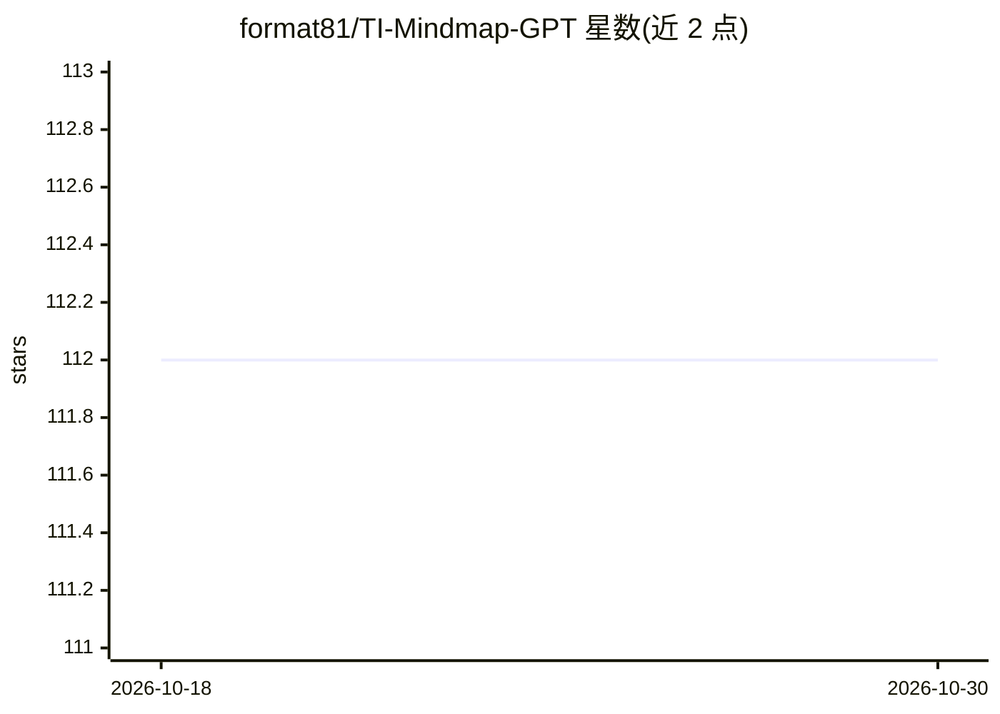

# format81/TI-Mindmap-GPT

⭐ 112 · Python · GPL-3.0 · 推送 2026-02-16 · [GitHub](https://github.com/format81/TI-Mindmap-GPT) · [官网](https://ti-mindmap-gpt.streamlit.app/) · 个人维护

**面向威胁情报团队的 LLM 摘要与思维导图生成工具（BYOK）**

基于 Streamlit 的威胁情报分析应用：读取 URL、上传 PDF 或粘贴文本，调用用户自带的 OpenAI/Azure OpenAI/MistralAI API Key（BYOK 模式）生成 Markdown 摘要、Mermaid.js/MarkMap 思维导图，并抽取 IOC（经 VirusTotal 富化）与 TTP（含执行时间线、MITRE ATT&CK Navigator 图层）、生成'5 Whats'威胁范围报告、STIX 2.1 bundle（beta）与 PDF 报告，另支持与已处理文章对话。限制：PyPDF2 不支持 OCR，反爬严格的网站可能失败，超长输入会截断。面向网络安全威胁情报分析师，逐篇手动处理。

## 筛选速览

| 维度 | 判定 | 备注 |
|---|---|---|
| AI 角色 | `ai-native` | 本体是模型或模型工具 |
| 许可风险 | `viral` | GPL-3.0 |
| 部署形态 | `None` |  |
| 模型依赖 | locked-api |  |
| 硬件要求 | — | 无带数字的原话,不猜 |
| 安装摩擦 | `low` | 无编译、无系统依赖或容器化 |
| 成熟度 | — | 结构信号不足 |

## 能力要点

- URL/PDF/文本多来源输入，生成摘要与 Mermaid/MarkMap 思维导图
- IOC 抽取与 VirusTotal 富化，TTP 表格与 Mermaid 时间线可视化
- 生成 MITRE ATT&CK Navigator 图层与 STIX 2.1 bundle（beta）
- BYOK 模式：使用用户自有 OpenAI/Azure OpenAI/MistralAI Key

## 适用场景

- 我把冗长的威胁情报文章转成摘要和思维导图快速阅读
- 我需要从报告中抽取 IOC 和 TTP 并映射到 MITRE ATT&CK
- 我要为分析结果导出 PDF 报告或 STIX 2.1 格式数据

## 场景标签

`网络安全` `文档问答` · 领域:知识与检索

## 证据(README 行号)

> L9: Navigating through lengthy blog posts, threat intelligence articles, or write-ups can be daunting, especially for cy
> L11: TI Mindmap is a tool developed using Large Language Models (LLMs). It's designed to assist cyber threat intelligenc
> L13: The app operates on a 'Bring Your Own (LLM) Key' model, allowing users to leverage their own Large Language Models 

## 星数曲线

2026-10-18 112 → 2026-10-30 112（+0）

---
*卡片 v1 · prompt 1.4 · 生成 2026-10-23 · 置信度 high · 依据 README sha `60c054ec908e` · [字段定义](../../DATASET.md)*
