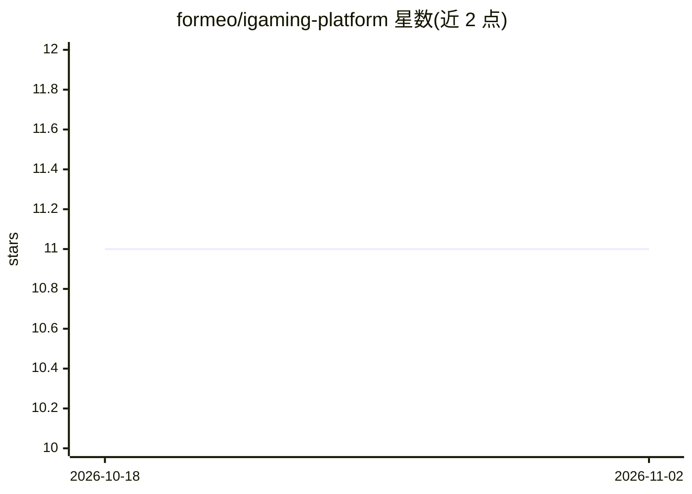

# formeo/igaming-platform

⭐ 11 · Go · MIT · 推送 2026-09-21 · [GitHub](https://github.com/formeo/igaming-platform) · 个人维护

**面向在线博彩/投注的微服务平台：钱包、奖金与反欺诈**

以 Go 编写的 iGaming 后端微服务集合，包含三个服务：Wallet Service（存取/投注/派彩、复式记账、幂等事务、事件溯源审计）、Bonus Engine（YAML 规则 DSL 配置存款匹配/免费旋转/返水等奖金类型、流水要求跟踪）、Risk & Prediction Service（规则+ML 集成的欺诈评分、奖金滥用检测、玩家 LTV 预测，特征存于 Redis+ClickHouse，ML 推理用 ONNX Runtime）。技术栈为 gRPC+PostgreSQL+RabbitMQ+Docker Compose，作者声明为作品集项目、许可限学习/作品集用途。

## 筛选速览

| 维度 | 判定 | 备注 |
|---|---|---|
| AI 角色 | `ai-enhanced` | 去掉 AI 部分产品仍成立 |
| 许可风险 | `permissive` | MIT |
| 部署形态 | `self-host` | docker 或自建部署 |
| 模型依赖 | — | README 未给出锁定关系 |
| 硬件要求 | — | 无带数字的原话,不猜 |
| 安装摩擦 | `low` | 无编译、无系统依赖或容器化 |
| 成熟度 | — | 结构信号不足 |

## 能力要点

- 复式记账账本与幂等事务、事件溯源审计的 Wallet Service
- YAML DSL 配置的奖金规则引擎（存款匹配/免费旋转/返水/流水要求）
- 规则+ML 集成的实时欺诈评分（<50ms）与 LTV 预测，ONNX Runtime 推理
- 含监管合规配置、责任博彩限额与 Grafana 监控面板

## 适用场景

- 搭建在线博彩/投注业务的钱包与账务后端
- 配置并运行存款匹配、返水等促销奖金规则
- 对交易做实时欺诈评分与奖金滥用检测

## 场景标签

`网络安全` · 领域:学习与行业

## 证据(README 行号)

> L10: > Production-ready microservices platform for iGaming: Wallet Service, Bonus Engine & ML-powered Fraud Detection.
> L41: ### 🛡️ Risk & Prediction Service
> L43: - **Fraud Scoring**: Rule-based + ML ensemble (< 50ms latency)

## 星数曲线

2026-10-18 11 → 2026-11-02 11（+0）

---
*卡片 v1 · prompt 1.4 · 生成 2026-11-02 · 置信度 mid · 依据 README sha `bbf09fc142e9` · [字段定义](../../DATASET.md)*
