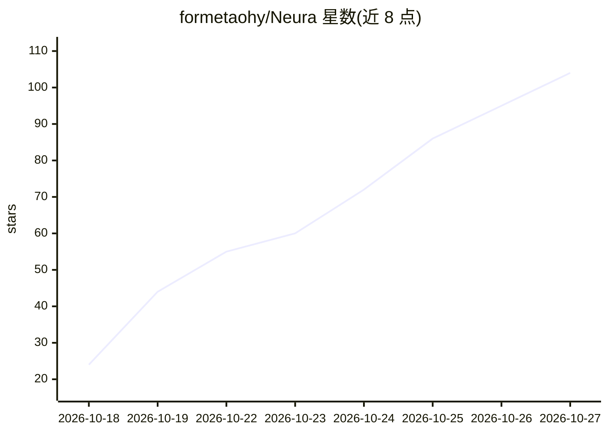

# formetaohy/Neura

⭐ 104 · Rust · MIT · 推送 2026-10-23 · [GitHub](https://github.com/formetaohy/Neura) · 个人维护

**面向游戏的 Rust AI 框架：用图形 API 本地训练运行模型，无需 CUDA**

用 Rust 编写的面向游戏的 AI 框架，通过游戏原生图形 API 在本地训练与运行 Qwen 等模型，不依赖 CUDA。训练与推理可直接嵌入游戏帧循环，无需 async/await；内核用 Rust 编写，由内置 AOT 编译器编译为 SPIR-V、HLSL、MSL 以实现跨平台。提供 Bevy 官方集成 bevy-neura 与可运行示例。MIT 许可，以 crate 形式发布。

## 筛选速览

| 维度 | 判定 | 备注 |
|---|---|---|
| AI 角色 | `ai-ecosystem` | LLM/agent 周边工具 |
| 许可风险 | `permissive` | MIT |
| 部署形态 | `None` |  |
| 模型依赖 | — | README 未给出锁定关系 |
| 硬件要求 | — | 无带数字的原话,不猜 |
| 安装摩擦 | `medium` | 含编译或系统依赖之一 |
| 成熟度 | — | 结构信号不足 |

## 能力要点

- 通过游戏原生图形 API 本地训练与推理，无需 CUDA
- 训练与推理可直接运行于游戏帧循环，无需 async/await
- 内置 AOT 编译器将 Rust 内核编译为 SPIR-V/HLSL/MSL
- 官方 Bevy 集成 bevy-neura

## 适用场景

- 在游戏内直接训练和运行 LLM 等模型
- 构建 AI-native 的 Bevy 游戏
- 在资源受限的本地设备上运行模型

## 场景标签

`推理引擎` `微调` · 领域:训练与推理

## 证据(README 行号)

> L12: Neura is an **AI framework designed for games**. It lets you **train and run models such as Qwen locally inside you
> L17: - **Game-loop Integration**: Run training and inference directly from your frame loop, without async/await.

## 星数曲线

2026-10-18 24 → 2026-10-27 104（+80）

---
*卡片 v1 · prompt 1.4 · 生成 2026-10-24 · 置信度 high · 依据 README sha `2ce2af4833d9` · [字段定义](../../DATASET.md)*
