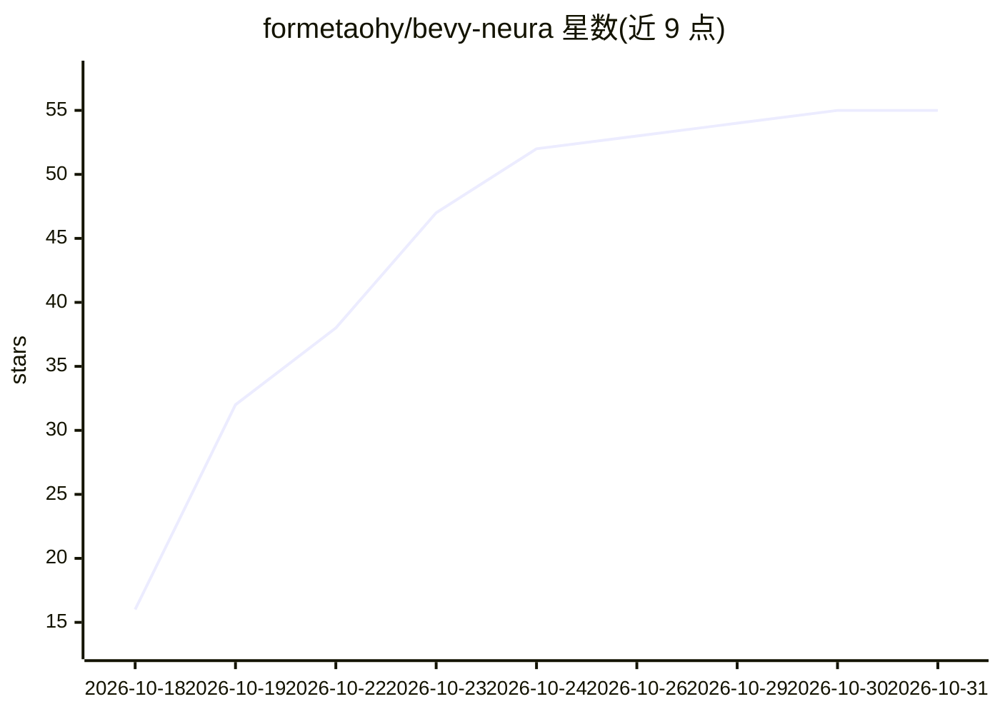

# formetaohy/bevy-neura

⭐ 55 · Rust · MIT · 推送 2026-10-18 · [GitHub](https://github.com/formetaohy/bevy-neura) · 个人维护

**Bevy 游戏引擎的 AI 原生训练与推理库**

基于自研 Neura 框架的 Bevy 插件库（Rust），使用 DX12、Metal、Vulkan 图形 API 执行神经网络训练与推理，供开发者在 Bevy 游戏中嵌入 AI 能力。提供游戏循环内同步训练/推理（无 async/await）、内核编译器（Rust 编写内核，生成 SPIR-V/HLSL/MSL）与端到端优化。附 MNIST 手写数字识别、实时语音转录、井字棋对弈 AI 三个示例。MIT 许可。

## 筛选速览

| 维度 | 判定 | 备注 |
|---|---|---|
| AI 角色 | `ai-ecosystem` | LLM/agent 周边工具 |
| 许可风险 | `permissive` | MIT |
| 部署形态 | `None` |  |
| 模型依赖 | — | README 未给出锁定关系 |
| 硬件要求 | — | 无带数字的原话,不猜 |
| 安装摩擦 | `low` | 无编译、无系统依赖或容器化 |
| 成熟度 | — | 结构信号不足 |

## 能力要点

- 游戏帧循环内直接运行训练与推理，无需 async/await
- 利用游戏原生图形 API（DX12/Metal/Vulkan）执行计算
- Rust 编写内核并生成 SPIR-V/HLSL/MSL，无需维护多套 shader
- 附 MNIST、实时语音转录、井字棋 AI 示例

## 适用场景

- 在 Bevy 游戏中嵌入可训练的 AI 对手
- 游戏内集成识别/转录等神经网络功能
- 用 Rust 编写自定义 GPU 计算内核用于游戏 AI

## 场景标签

`推理引擎` `模型训练` · 领域:训练与推理

## 证据(README 行号)

> L24: ## What is bevy-neura?
> L26: **bevy-neura** is built on **Neura**, using **DX12, Metal, and Vulkan** for neural network training and inference, 

## 星数曲线

2026-10-18 16 → 2026-10-31 55（+39）

---
*卡片 v1 · prompt 1.4 · 生成 2026-10-24 · 置信度 high · 依据 README sha `52811ab561ac` · [字段定义](../../DATASET.md)*
