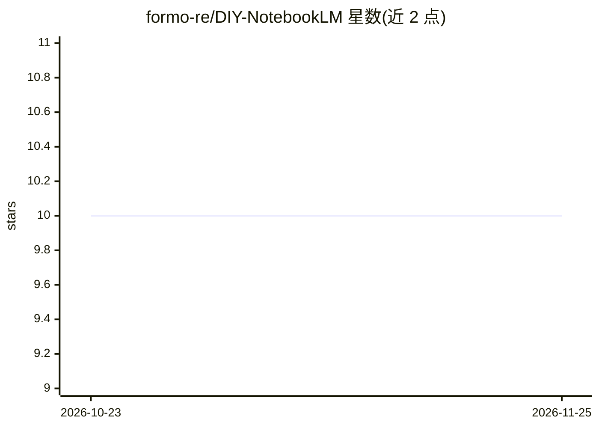

# formo-re/DIY-NotebookLM

⭐ 10 · MIT · 推送 2026-05-31 · [GitHub](https://github.com/formo-re/DIY-NotebookLM) · [官网](https://youtu.be/keQwKXHx50Q) · 个人维护 · 中文 README

**用 Gemini Notebook 打造陪伴式读书 AI 精灵的方法**

一套基于 Gemini Notebook 内建功能的读书方法，不含需安装的软件：用 Gem（Mekvong）从 PDF 萃取结构化 Book Heart YAML，再贴入使用说明指令（Lugiok_CI.md）建立笔记本，上传 Book Heart 与原书 PDF 作为来源，让 AI 依据原书进行长期陪伴式对话。机制上依赖笔记本的对话记忆、使用说明与来源限制，内置反幻觉约束（回答须来自原书），并提供六种按书类型自动选择的互动模式、Canvas 概念图与 Suin 读书笔记整理。全部操作在 gemini.google.com 完成，免费功能。

## 筛选速览

| 维度 | 判定 | 备注 |
|---|---|---|
| AI 角色 | `ai-native` | 本体是模型或模型工具 |
| 许可风险 | `permissive` | MIT |
| 部署形态 | `None` |  |
| 模型依赖 | — | README 未给出锁定关系 |
| 硬件要求 | — | 无带数字的原话,不猜 |
| 安装摩擦 | `low` | 无编译、无系统依赖或容器化 |
| 成熟度 | — | 结构信号不足 |

## 能力要点

- 两角色架构：Gem 萃取 Book Heart + 笔记本化身读书精灵
- 六种按书类型自动切换的互动模式（苏格拉底探究/教学验证等）
- 依赖笔记本自动对话记忆，跨会话接续读书进度
- 内置反幻觉机制，回答须来自原书或 Book Heart

## 适用场景

- 把一本想精读的书变成可长期对话的 AI 读书伙伴
- 为哲学、技术书、小说等不同类型书选择合适的学习方式
- 将多本书的 Book Heart 放入同一笔记本做对比阅读
- 定期让 AI 把划线与想法整理成结构化读书笔记

## 场景标签

`文档问答` `聊天机器人` · 领域:对话与助手

## 证据(README 行号)

> L9: 一套利用 **Gemini Notebook** 內建功能，**讓書本變身成一個精靈，陪伴你讀書、為你解惑**的方法。
> L24: 這套系統用到 Gemini 的兩個免費功能，不需要安裝任何軟體，打開瀏覽器就能用：

## 星数曲线

2026-10-23 10 → 2026-11-25 10（+0）

---
*卡片 v1 · prompt 1.4 · 生成 2026-11-19 · 置信度 high · 依据 README sha `184857994514` · [字段定义](../../DATASET.md)*
