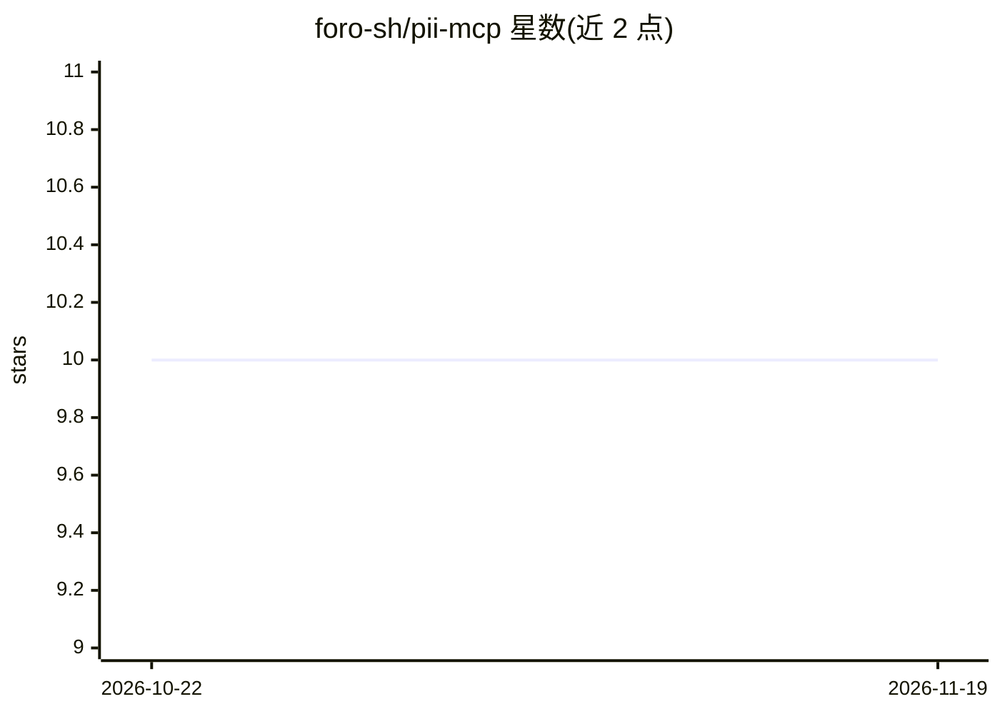

# foro-sh/pii-mcp

⭐ 10 · Python · MIT · 推送 2026-11-03 · [GitHub](https://github.com/foro-sh/pii-mcp) · [官网](https://pypi.org/project/pii-mcp/) · 个人维护

**给 MCP 服务器开发者：在结果送达 LLM 前遮蔽 PII**

pii-mcp 是 MCP 工具结果的 PII 遮蔽库，基于正则与校验和识别邮箱、IBAN、银行卡、社保号、电话、地址、车牌等结构化标识符，并将 API key/JWT/Bearer 替换为占位符。提供 FastMCP 一行式中间件（仅处理结果，失败或超尺寸即扣留、不转发未遮蔽文本），Python 与 TypeScript 双运行时共享 Rust 核心（PyO3/N-API 平台 wheel），支持 en/nl/de 语言包、types 过滤与 allow 白名单。范围限定 Tier 1 模式匹配，不含 NER 模型；人名/自由文本建议由 Presidio 等 Tier 2 处理。

## 筛选速览

| 维度 | 判定 | 备注 |
|---|---|---|
| AI 角色 | `ai-ecosystem` | LLM/agent 周边工具 |
| 许可风险 | `permissive` | MIT |
| 部署形态 | `library` | 以包/库形式分发 |
| 模型依赖 | — | README 未给出锁定关系 |
| 硬件要求 | — | 无带数字的原话,不猜 |
| 安装摩擦 | `low` | 无编译、无系统依赖或容器化 |
| 成熟度 | — | 结构信号不足 |

## 能力要点

- FastMCP 中间件一行接入，scrub 失败或超尺寸时扣留结果、绝不未遮蔽转发
- 正则+校验和覆盖邮箱/IBAN/银行卡/SSN/NHS 等结构化标识符及凭据
- Python + TypeScript 共享 Rust 核心，平台 wheel 内置原生加速，可选纯 Python 回退
- en/nl/de 语言包、types 过滤与 allow 白名单（secret 不可豁免）

## 适用场景

- MCP 服务器返回工具结果前遮蔽用户个人数据
- 拦截工具输出中的 API key/JWT 泄漏到 LLM
- GDPR 场景下对结构化标识符做模式层脱敏

## 场景标签

`网络安全` · 领域:学习与行业

## 证据(README 行号)

> L3: Pattern-based PII redaction for MCP servers (regex + checksums). Masks emails,
> L50: mcp.add_middleware(PiiScrubMiddleware())  # languages=["en", "nl"] by default

## 星数曲线

2026-10-22 10 → 2026-11-19 10（+0）

---
*卡片 v1 · prompt 1.4 · 生成 2026-11-19 · 置信度 high · 依据 README sha `2b581b1a058a` · [字段定义](../../DATASET.md)*
