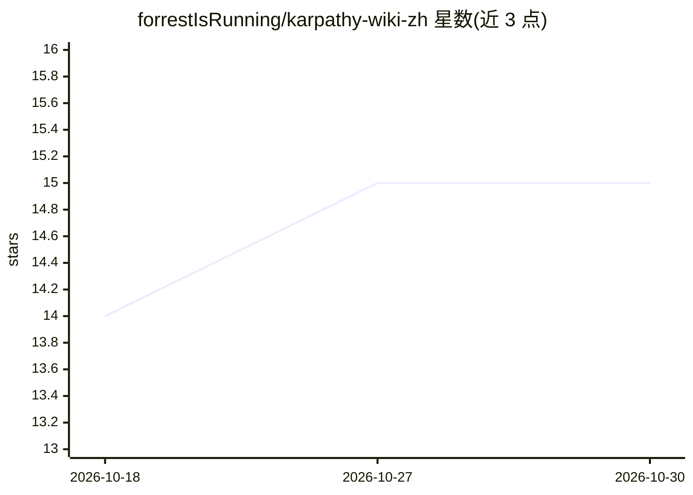

# forrestIsRunning/karpathy-wiki-zh

⭐ 15 · 推送 2026-05-10 · [GitHub](https://github.com/forrestIsRunning/karpathy-wiki-zh) · [官网](https://github.com/forrestIsRunning/karpathy-wiki-zh) · 个人维护 · 中文 README

**Karpathy 全部公开内容的中文学习知识库（186 个文件）**

将 karpathy.ai 上所有公开内容（博客、视频、论文、CS231n 课程、演讲、开源项目、书单）整理为 186 个 Markdown 文件的中文知识库，每篇提供中文翻译与通俗解释，标注原始链接。按博客 89 篇、视频 39 个、教学 13 篇、项目 17 个、论文 18 篇等类别组织，附学习路径与主题交叉索引。非官方仓库，内容为 Markdown 格式，通过 git clone 或 GitHub 在线浏览阅读。

## 筛选速览

| 维度 | 判定 | 备注 |
|---|---|---|
| AI 角色 | `ai-knowledge` | 知识聚合/清单类 |
| 许可风险 | `none` | — |
| 部署形态 | `None` |  |
| 模型依赖 | — | README 未给出锁定关系 |
| 硬件要求 | — | 无带数字的原话,不猜 |
| 安装摩擦 | `low` | 无编译、无系统依赖或容器化 |
| 成熟度 | — | 结构信号不足 |

## 能力要点

- 186 个文件覆盖 karpathy.ai 所有链接，标注原始来源
- 42 篇博客全文 + 15 篇论文摘要 + 25 个演讲的中文通俗解释
- 提供按水平的 LEARNING_PATH.md 学习路径与主题交叉索引
- 全部 Markdown 编写，方便阅读、搜索和 AI 处理

## 适用场景

- 零基础中文读者系统学习 Karpathy 的 AI 内容
- 按主题查找特定概念（如 Software 2.0、反向传播）的通俗解释
- AI 教育工作者获取简单易懂的中文教学素材

## 场景标签

`教程课程` · 领域:学习与行业

## 证据(README 行号)

> L1: # 🧠 Karpathy Wiki ZH — Andrej Karpathy 中文知识库
> L3: > **把 karpathy.ai 上所有内容全部读完了** — 博客、视频、论文、课程、演讲、项目。每篇都用最通俗易懂的中文解释清楚了。
> L14: |**📚 186 个文件**|覆盖 karpathy.ai 所有链接，零遗漏|

## 星数曲线

2026-10-18 14 → 2026-10-30 15（+1）

---
*卡片 v1 · prompt 1.4 · 生成 2026-10-30 · 置信度 high · 依据 README sha `e2d855f5b659` · [字段定义](../../DATASET.md)*
