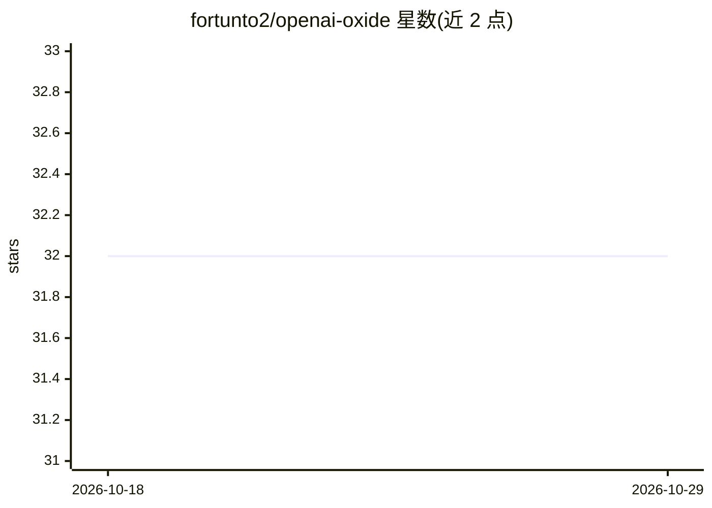

# fortunto2/openai-oxide

⭐ 32 · Rust · MIT · 推送 2026-08-22 · [GitHub](https://github.com/fortunto2/openai-oxide) · [官网](https://fortunto2.github.io/openai-oxide/) · 个人维护

**Rust 核心、多语言绑定的 OpenAI API 客户端 SDK**

以 Rust crate 为单一核心实现的 OpenAI API 客户端，覆盖 Responses API、Chat Completions 等 20+ 端点，类型由独立 openai-types crate 提供（1100+ 类型，从 Python SDK 自动同步）。通过 napi-rs、PyO3、WASM 提供 Node.js、Python 与浏览器绑定。特性包括流式解析、WebSocket 连接池、结构化输出、函数调用早期解析、对冲请求与 HMAC webhook 校验。面向构建 agent 工作流与跨平台嵌入 AI 层的开发者。

## 筛选速览

| 维度 | 判定 | 备注 |
|---|---|---|
| AI 角色 | `ai-ecosystem` | LLM/agent 周边工具 |
| 许可风险 | `permissive` | MIT |
| 部署形态 | `library` | 以包/库形式分发 |
| 模型依赖 | — | README 未给出锁定关系 |
| 硬件要求 | — | 无带数字的原话,不猜 |
| 安装摩擦 | `low` | 无编译、无系统依赖或容器化 |
| 成熟度 | — | 结构信号不足 |

## 能力要点

- Rust 单核心 + Node/Python/WASM 绑定，跨平台共享同一实现
- Responses API 持久 WebSocket 模式与连接池（WsPool）
- 类型安全结构化输出 parse::<T>()（schemars 自动生成 JSON schema）
- 函数调用流式早期解析，arguments.done 即可开始执行本地工具

## 适用场景

- 在 Rust 项目中接入 OpenAI Responses API 与 Chat Completions
- 跨平台应用（含浏览器/WASM）嵌入统一的 OpenAI 调用层
- agent 工作流中降低 SDK 开销与尾部延迟（对冲请求、连接池）

## 场景标签

 · 领域:LLM 基础设施/API 客户端

## 证据(README 行号)

> L3:  Feature-complete OpenAI client for Rust , Node.js , and Python . Streaming, WebSockets, structured outputs, WASM. B
> L14: `openai-oxide` implements the full Responses API, Chat Completions, and 20+ other endpoints with **persistent WebSo

## 星数曲线

2026-10-18 32 → 2026-10-29 32（+0）

---
*卡片 v1 · prompt 1.4 · 生成 2026-10-26 · 置信度 high · 依据 README sha `652c1b88baae` · [字段定义](../../DATASET.md)*
