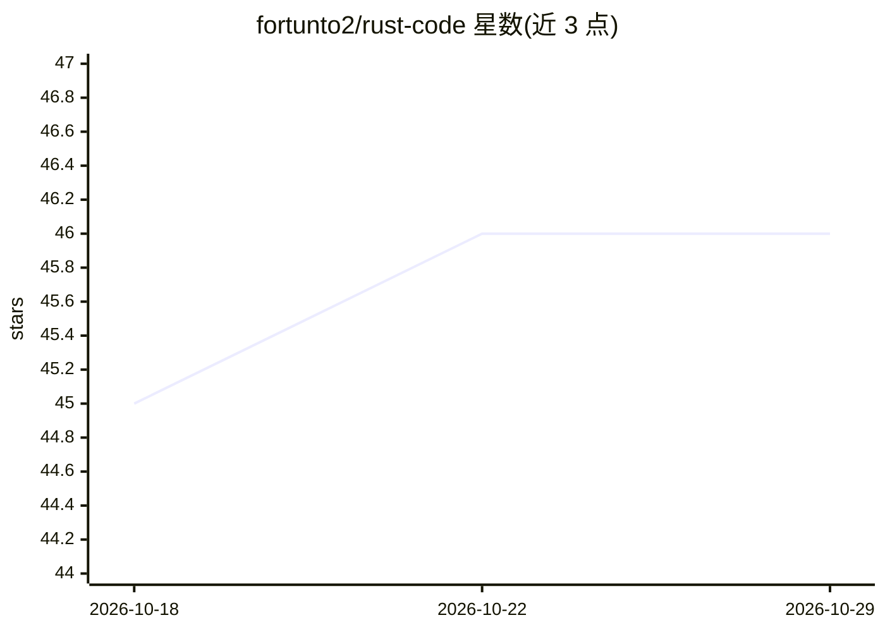

# fortunto2/rust-code

⭐ 46 · Rust · MIT · 推送 2026-08-22 · [GitHub](https://github.com/fortunto2/rust-code) · 个人维护

**Rust 编写的终端 AI 编程 agent，TUI 交互与自主任务循环**

基于 Ratatui 的终端编程 agent：内置 22 个工具（文件读写、bash 前后台、git、记忆、任务、agent swarm、MCP、OpenAPI 转工具等），以 SGR 类型化工具分派驱动 agent 循环，默认走 Gemini Pro→Flash→Flash Lite 降级链。支持多种 LLM 后端（Google/Anthropic/OpenAI/OpenRouter/Ollama/vLLM 等 OpenAI 兼容端点），提供模糊文件与符号搜索、tmux 后台任务实时预览、skills.sh 技能安装、BigHead 自主循环与自演化模式。经 Homebrew、install.sh 脚本或 cargo 安装，需 tmux 等依赖（doctor 可自动安装）。

## 筛选速览

| 维度 | 判定 | 备注 |
|---|---|---|
| AI 角色 | `ai-native` | 本体是模型或模型工具 |
| 许可风险 | `permissive` | MIT |
| 部署形态 | `library` | 以包/库形式分发 |
| 模型依赖 | local-ok | 支持本地模型 |
| 硬件要求 | — | 无带数字的原话,不猜 |
| 安装摩擦 | `low` | 无编译、无系统依赖或容器化 |
| 成熟度 | — | 结构信号不足 |

## 能力要点

- 22 个内置工具与 SGR 类型化工具分派循环
- BigHead 自主循环（断路器、控制文件）与自演化模式
- 任意 REST API 经 OpenAPI 规范转为可搜索调用的工具
- 模糊文件/符号搜索、tmux 后台任务实时预览、MCP 外部工具接入

## 适用场景

- 在终端里用自然语言完成代码审查、修 bug、加功能
- 把常用 REST API 接入 agent 作为工具直接调用
- 跑自主循环批量执行多步骤编程任务

## 场景标签

`编码 Agent` · 领域:编码与开发

## 证据(README 行号)

> L7: `rust-code` is a terminal coding agent written in Rust.
> L9: It combines a Ratatui-based TUI, typed tool execution, fuzzy navigation, session history, and an SGR-driven agent lo
> L52: - **SGR agent loop** — typed tool execution with fallback chain (Gemini Pro → Flash → Flash Lite)

## 星数曲线

2026-10-18 45 → 2026-10-29 46（+1）

---
*卡片 v1 · prompt 1.4 · 生成 2026-10-25 · 置信度 high · 依据 README sha `22d284e2aabc` · [字段定义](../../DATASET.md)*
