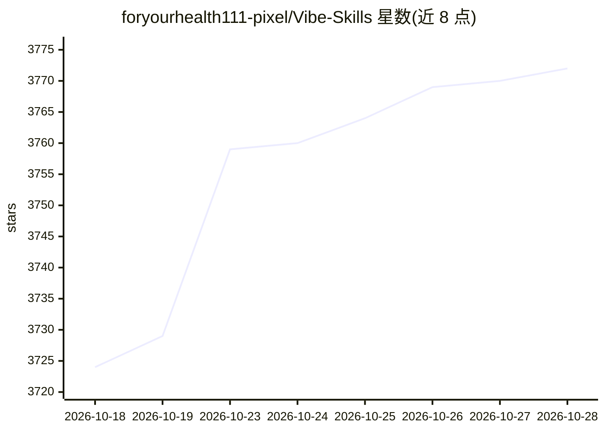

# foryourhealth111-pixel/Vibe-Skills

⭐ 3,776 · Python · Apache-2.0 · 推送 2026-10-26 · [GitHub](https://github.com/foryourhealth111-pixel/Vibe-Skills) · 个人维护 · 中文 README

**面向 AI agent 的本地 Skill 路由与工作流编排工具**

VibeSkills 是一个通用 Skill，为 AI agent 提供从接收任务到验收交付的流程：确认需求、推荐 L/XL 两种规模级别、将任务拆解为子任务、扫描本地配置的 Skill 文件夹（含 SKILL.md）并按依赖关系为各部分分派合适 Skill，执行后逐项核对计划完成情况。Skill 发现在本地进行，先提取名称/描述等紧凑信息做候选筛选，再按需读取完整 SKILL.md，以控制上下文开销。任务记录（需求、计划、进度、验收）保存在同一记录中，可跨会话续作。README 报告在 SkillsBench（DeepSeekV4Flash-VE + OpenHands 基线）上平均任务得分 +21.12%、token 消耗 -29.6% 的测量结果。

## 筛选速览

| 维度 | 判定 | 备注 |
|---|---|---|
| AI 角色 | `ai-ecosystem` | LLM/agent 周边工具 |
| 许可风险 | `permissive` | Apache-2.0 |
| 部署形态 | `None` |  |
| 模型依赖 | — | README 未给出锁定关系 |
| 硬件要求 | — | 无带数字的原话,不猜 |
| 安装摩擦 | `low` | 无编译、无系统依赖或容器化 |
| 成熟度 | — | 结构信号不足 |

## 能力要点

- 任务拆解为可验证子任务，按依赖顺序编排本地 Skill
- L/XL 两级任务规模，XL 支持最多两个不冲突部分并行
- 本地索引 + 候选筛选 + 按需读取 SKILL.md 以控制 token 开销
- 任务记录含需求、计划、进度与验收，支持跨会话续作

## 适用场景

- 本地装了大量 Skill 后，让 agent 自动发现并选用合适的 Skill
- 把复杂任务拆解为子任务并为各部分匹配不同领域 Skill
- 对 agent 交付结果做计划逐项核对与验收

## 场景标签

`Agent 框架` `工作流自动化` · 领域:Agent 开发

## 证据(README 行号)

> L7:  VibeSkills is a general-purpose Skill that automatically routes local Skills and intelligently orchestrates harness
> L113: VibeSkills reviews the local Skill folders you configure, then

## 星数曲线

2026-10-18 3,724 → 2026-10-28 3,772（+48）

---
*卡片 v1 · prompt 1.4 · 生成 2026-10-20 · 置信度 mid · 依据 README sha `f7bb22c40021` · [字段定义](../../DATASET.md)*
