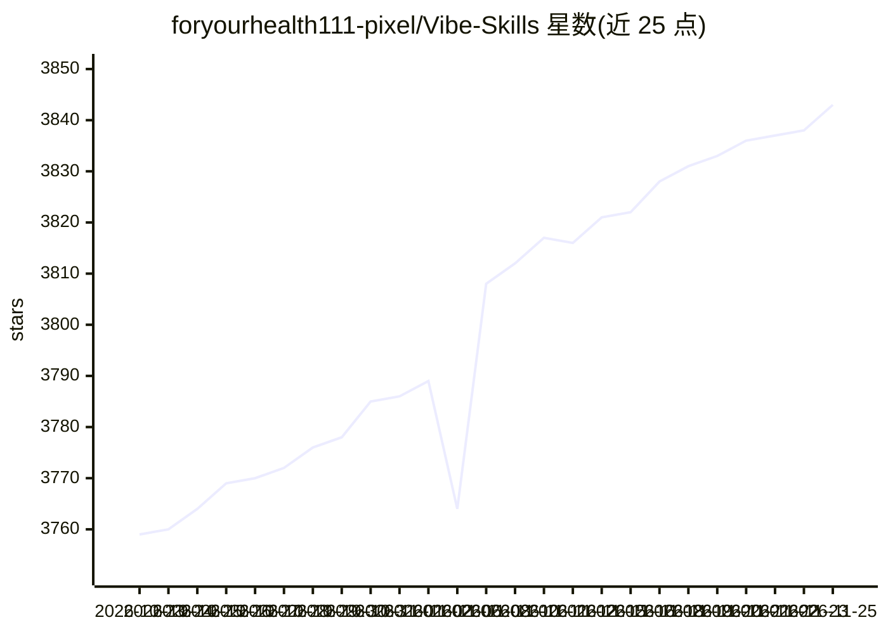

# foryourhealth111-pixel/Vibe-Skills

⭐ 3,843 · Python · Apache-2.0 · 推送 2026-11-09 · [GitHub](https://github.com/foryourhealth111-pixel/Vibe-Skills) · 个人维护 · 中文 README

**为 AI agent 自动路由本地 Skills 并编排工作流的通用 Skill**

VibeSkills 本身是一个通用 Skill，面向使用 agent/harness 框架的开发者：读取本地配置的 Skill 文件夹，提取名称、描述、用途等索引信息，将复杂任务拆解为可验证子任务并从中筛选匹配的 Skills 分配给各模块，最后按计划逐项检查交付结果。提供 L/XL 两级流程，XL 支持最多两个非冲突部分并行；代码任务可进入 TDD 循环；完成/失败/阻塞状态被记录以便后续会话继续。官方在 SkillsBench 上基于 DeepSeekV4Flash-VE 与 OpenHands 基线报告了对照实验结果，并提供可复现的研究数据仓库。

## 筛选速览

| 维度 | 判定 | 备注 |
|---|---|---|
| AI 角色 | `ai-ecosystem` | LLM/agent 周边工具 |
| 许可风险 | `permissive` | Apache-2.0 |
| 部署形态 | `None` |  |
| 模型依赖 | — | README 未给出锁定关系 |
| 硬件要求 | — | 无带数字的原话,不猜 |
| 安装摩擦 | `low` | 无编译、无系统依赖或容器化 |
| 成熟度 | — | 结构信号不足 |

## 能力要点

- 本地 Skill 索引与候选短名单机制，按需读取 SKILL.md 而非全量入上下文
- L/XL 两级任务分解，XL 支持最多两个非冲突部分并行
- SKILL.md 路由与工作单元分配记录（agent_skill_organization / module_assignments）
- 17 项交付前检查与状态记录以支持跨会话续作

## 适用场景

- 本地安装了大量 Skills 后让 agent 自动发现、选择并编排相关 Skill
- 把机器学习实验等多交付物任务拆分为可检查的工作单元
- 减少 agent 反复试错带来的 token 与工具调用开销

## 场景标签

`Agent 框架` · 领域:Agent 开发

## 证据(README 行号)

> L7:  VibeSkills is a general-purpose Skill that automatically routes local Skills and intelligently orchestrates harness
> L48: Instead, it first clarifies the task objective and delivery requirements, then decomposes a complex task into sever

## 星数曲线

2026-10-23 3,759 → 2026-11-25 3,843（+84）

---
*卡片 v1 · prompt 1.4 · 生成 2026-11-23 · 置信度 high · 依据 README sha `cf60bef8351a` · [字段定义](../../DATASET.md)*
