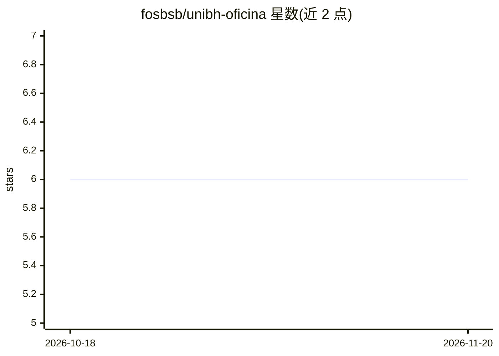

# fosbsb/unibh-oficina

⭐ 6 · Python · MIT · 推送 2026-10-06 · [GitHub](https://github.com/fosbsb/unibh-oficina) · 组织维护

**UniBH 教学工坊：4小时在应用中接入 LLM（流式对话、JSON 校验、RAG）**

巴西 UniBH 的教学项目（material didático），引导参与者用 4 小时从零构建 Estuda.AI——数据库课程的学习助手应用。分 5 个阶段实现：调用 LLM API、流式聊天（system prompt）、生成经过 Pydantic 校验的 JSON 测验题、基于自编讲义的 RAG 问答（本地 Ollama 生成 embeddings、pgvector 向量检索、reranking 并引用来源），以及自由扩展挑战。技术栈为 FastAPI + Ollama Cloud + 本地 Ollama + pgvector，三个服务通过 docker compose 一键启动，配套 pytest 测试与常见错误排查文档。

## 筛选速览

| 维度 | 判定 | 备注 |
|---|---|---|
| AI 角色 | `ai-ecosystem` | LLM/agent 周边工具 |
| 许可风险 | `permissive` | MIT |
| 部署形态 | `desktop` | 安装包/桌面程序 |
| 模型依赖 | local-ok | 支持本地模型 |
| 硬件要求 | — | 无带数字的原话,不猜 |
| 安装摩擦 | `low` | 无编译、无系统依赖或容器化 |
| 成熟度 | — | 结构信号不足 |

## 能力要点

- 分阶段教学路径：API 调用→流式聊天→结构化 JSON 输出→RAG 引用来源
- docker compose 一次性启动 app、Ollama 本地容器与 pgvector 三个服务
- RAG 管道含 embeddings、向量相似检索与 reranking，回答引用讲义出处
- 配套 pytest 验证脚本与错误排查表

## 适用场景

- 按工坊步骤学习在自有应用中接入 LLM
- 学习用 pgvector 搭建带来源引用的 RAG
- 练习 LLM 结构化 JSON 输出与校验重试
- 作为数据库课程的教学辅助材料

## 场景标签

`教程课程` `RAG` · 领域:知识与检索

## 证据(README 行号)

> L30: Em 4 horas, você constrói o **Estuda.AI**, um assistente de estudos da disciplina de Banco de Dados. Etapa por etap
> L57: |**App (FastAPI)**|O código que você escreve em `app/`: monta as mensagens, valida as respostas e orquestra tudo|Co
> L62: O app, o Ollama local e o pgvector sobem juntos, em containers, com um único `docker compose`; o navegador é o seu 

## 星数曲线

2026-10-18 6 → 2026-11-20 6（+0）

---
*卡片 v1 · prompt 1.4 · 生成 2026-11-20 · 置信度 high · 依据 README sha `4866e6ae5058` · [字段定义](../../DATASET.md)*
