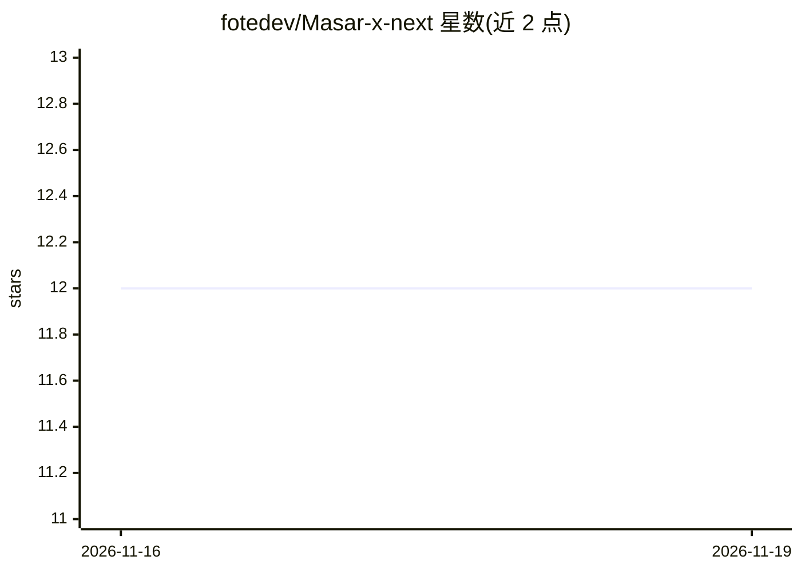

# fotedev/Masar-x-next

⭐ — · [GitHub]() · 组织维护

**面向大学生的双语 AI 学习平台：资料、测验与 AI 辅导**

一个面向大学学生的学习平台，提供学习摘要、互动课程、测验、成绩跟踪、考试资料库与课程表，支持英/阿双语及 RTL 本地化。AI 辅导通过服务端边界提供（API key 不下发到客户端）；技术栈为 Next.js 16、Supabase、Electron、Expo 的 pnpm monorepo，Web 端已上线，桌面与移动端仍在开发。限制：依赖自建 Supabase 项目与多项云服务配置（Cloudinary 等）。

## 筛选速览

| 维度 | 判定 | 备注 |
|---|---|---|
| AI 角色 | `ai-enhanced` | 去掉 AI 部分产品仍成立 |
| 许可风险 | `viral` | — |
| 部署形态 | `desktop` | 安装包/桌面程序 |
| 模型依赖 | — | README 未给出锁定关系 |
| 硬件要求 | — | 无带数字的原话,不猜 |
| 安装摩擦 | `low` | 无编译、无系统依赖或容器化 |
| 成熟度 | — | 结构信号不足 |

## 能力要点

- 学习资料库、测验与成绩跟踪，服务端权威判分
- AI 辅导走服务端边界，密钥不下发客户端
- Web/桌面/移动三端共享同一 Supabase 后端与共享包
- 英/阿双语本地化与 RTL 支持

## 适用场景

- 大学生集中管理学习资料与课程表
- 为课程生成测验并跟踪成绩
- 通过 AI 辅导获取学习帮助

## 场景标签

`RAG` · 领域:知识与检索

## 证据(README 行号)

> L7: Study summaries, interactive courses, quizzes, AI-powered assistance, and complete learning management — bilingual (
> L23: - **AI-powered assistance** — study help served through a hardened server-side boundary (provider keys never reach 
> L157: |Web|Next.js 16, React 19, TypeScript, Tailwind, Framer Motion|**Live in production**|

## 星数曲线

2026-11-16 12 → 2026-11-19 12（+0）

---
*卡片 v1 · prompt 1.4 · 生成 2026-11-18 · 置信度 mid · 依据 README sha `eb39a542f764` · [字段定义](../../DATASET.md)*
