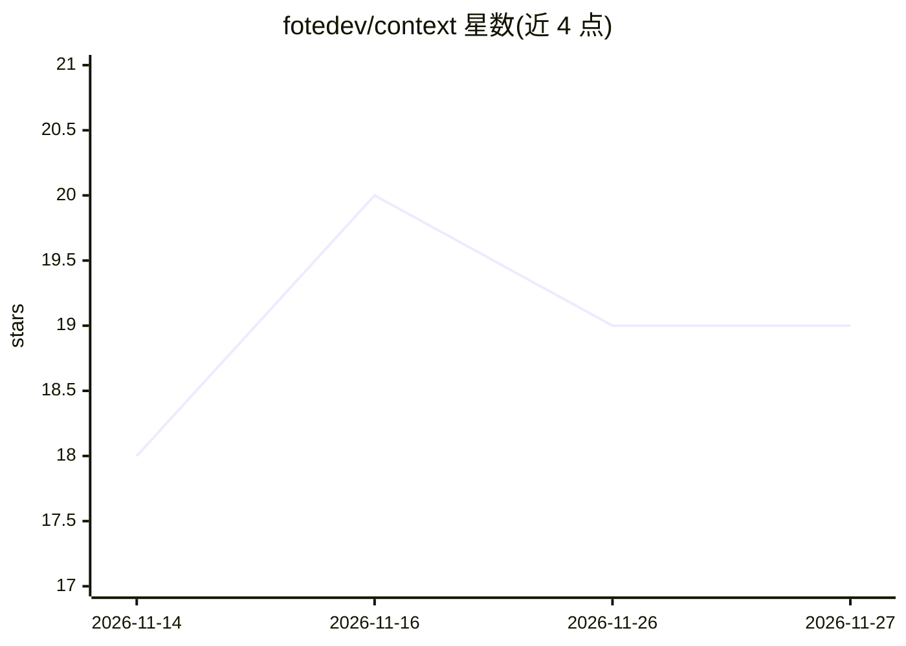

# fotedev/context

⭐ 19 · Python · 推送 2026-11-14 · [GitHub](https://github.com/fotedev/context) · 个人维护

**文件聚合器：把选定文件转为 LLM 上下文并用 Gemini 裁判比较模型回答**

Python 工具，将指定文件与代码片段（支持行区间、多区间、结构提取）聚合成发送给 LLM 的上下文文件，同时生成项目结构树，并基于 tiktoken 进行 token 计数。围绕 LMArena 使用场景设计：每个输入对应一个编号 Arena 文件夹，模型回答粘贴进 arena 文件后，可调用 Gemini Flash API 作为裁判自动比较 2 或 4 个模型的输出并宣布胜者。提供 CLI、TUI、Tkinter GUI 三种界面，另有 Chrome 扩展；可选库 tiktoken 与 textual 通过 install.py 安装。

## 筛选速览

| 维度 | 判定 | 备注 |
|---|---|---|
| AI 角色 | `ai-ecosystem` | LLM/agent 周边工具 |
| 许可风险 | `none` | — |
| 部署形态 | `library` | 以包/库形式分发 |
| 模型依赖 | — | README 未给出锁定关系 |
| 硬件要求 | — | 无带数字的原话,不猜 |
| 安装摩擦 | `low` | 无编译、无系统依赖或容器化 |
| 成熟度 | — | 结构信号不足 |

## 能力要点

- 文件/代码片段聚合成 LLM 上下文，支持行区间与结构（Types/Interfaces）提取
- Gemini Flash API 裁判自动比较模型回答并给出胜者与技术理由
- 基于 tiktoken 的 token 计数（未安装时降级估算）
- CLI/TUI/GUI 多界面与编号 Arena 文件夹组织输出

## 适用场景

- 把项目代码打包成可粘贴给 LLM 的上下文
- 在 LMArena 上对比多个模型的回答并由 AI 裁判判定胜者
- 按 Arena 编号管理多轮模型对比实验记录

## 场景标签

`提示工程` `模型评测` · 领域:Agent 开发

## 证据(README 行号)

> L8: The **Gemini Flash API** is integrated to act as an "independent judge and evaluator" of model outputs:
> L137: 1. **`context_output/arenas/NNN-<name>/NNN-context.{md,txt}`**: all aggregated files and snippets.
> L139: 3. **`context_output/arenas/NNN-<name>/NNN-arena.{md,txt}`**: the model comparison file with the **analytical repo

## 星数曲线

2026-11-14 18 → 2026-11-27 19（+1）

---
*卡片 v1 · prompt 1.4 · 生成 2026-11-18 · 置信度 mid · 依据 README sha `db889174c8e9` · [字段定义](../../DATASET.md)*
