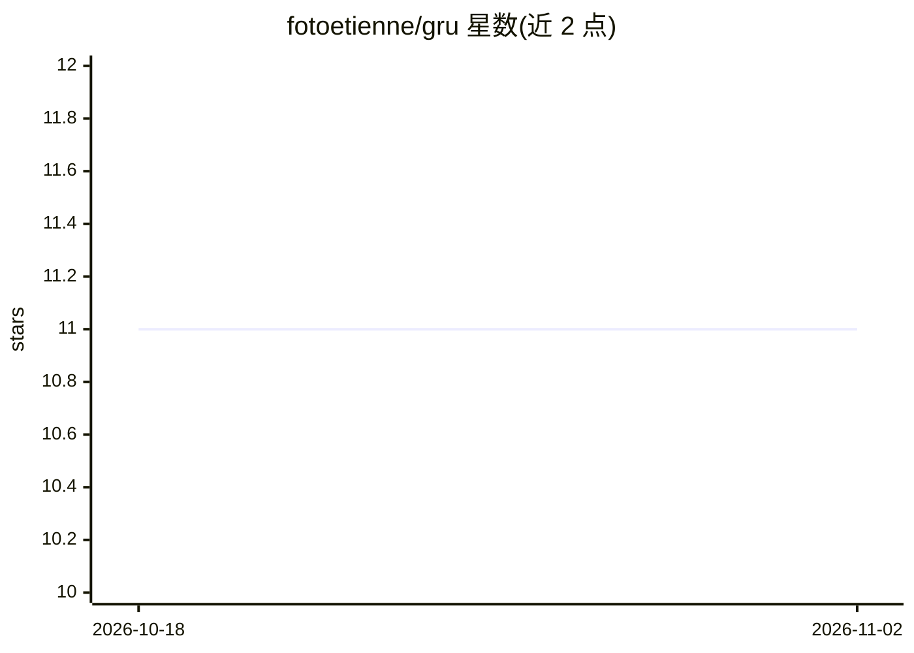

# fotoetienne/gru

⭐ 11 · Rust · Apache-2.0 · 推送 2026-10-02 · [GitHub](https://github.com/fotoetienne/gru) · 个人维护

**把 GitHub issue 自动变成合并 PR 的本地多 agent 编排 CLI**

Rust 编写的命令行工具，在本地把 GitHub issue 交给 AI 编码 agent 处理：创建隔离 git worktree、生成 agent 会话（Minion）、提交后运行 code-reviewer 子 agent、开 PR、监控 CI 并自动修复失败、转发 review 评论。自带 Claude Code、OpenAI Codex、Pi 三种后端，可用 --agent 切换；支持 PR 审查、交互聊天、PM/TPM 会话、守护进程 Lab Mode 与 MCP server。前置依赖为 GitHub CLI 与至少一个 agent 后端，提供预编译二进制与 cargo 源码安装。

## 筛选速览

| 维度 | 判定 | 备注 |
|---|---|---|
| AI 角色 | `ai-ecosystem` | LLM/agent 周边工具 |
| 许可风险 | `permissive` | Apache-2.0 |
| 部署形态 | `library` | 以包/库形式分发 |
| 模型依赖 | locked-api |  |
| 硬件要求 | — | 无带数字的原话,不猜 |
| 安装摩擦 | `low` | 无编译、无系统依赖或容器化 |
| 成熟度 | — | 结构信号不足 |

## 能力要点

- issue→worktree→PR→CI 自动修复的完整生命周期自动化
- agent 无关架构，自带 Claude Code / OpenAI Codex / Pi 后端并可插拔扩展
- Minion 会话管理、Lab Mode 守护进程轮询 gru:todo issue
- 可作为 MCP server 向 Claude 会话暴露 Minion 状态

## 适用场景

- 让 AI agent 自主实现 GitHub issue 并交付通过 CI 的 PR
- 并行管理多个 agent 任务（Minion）的状态与日志
- 自动审查 PR 或作为 PM/TPM 辅助会话使用

## 场景标签

`多智能体` `编码 Agent` · 领域:Agent 开发

## 证据(README 行号)

> L13: Gru is **agent-agnostic**. It ships with backends for Claude Code, OpenAI Codex, and Pi, and its pluggable architec
> L115: Gru is not tied to any single AI backend. Use the `--agent` flag to switch:
> L163: Gru can act as an MCP (Model Context Protocol) server, giving any Claude session live access to Minion status, log

## 星数曲线

2026-10-18 11 → 2026-11-02 11（+0）

---
*卡片 v1 · prompt 1.4 · 生成 2026-11-02 · 置信度 mid · 依据 README sha `5c2d89083be2` · [字段定义](../../DATASET.md)*
