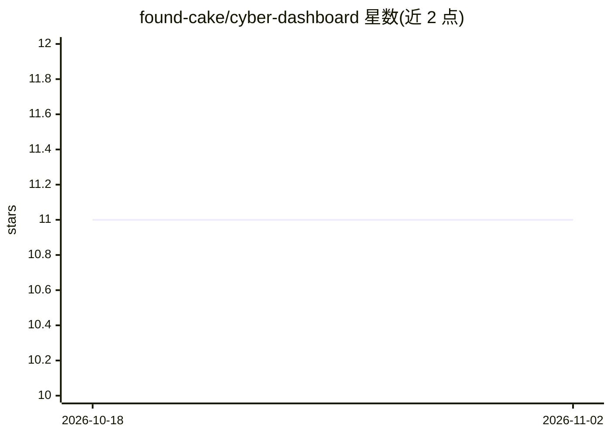

# found-cake/cyber-dashboard

⭐ 11 · Go · MIT · 推送 2026-10-28 · [GitHub](https://github.com/found-cake/cyber-dashboard) · 个人维护 · 中文 README

**本地运行的网络安全新闻与 CVE 分析仪表盘**

单可执行文件运行的本地应用：从七个安全新闻源采集 RSS 与文章正文，通过用户自备的 OpenAI 兼容 LLM 端点对文章做分类与摘要（攻击方式、威胁行为者、受害规模、零日信号等），并用 NVD 数据富化 CVE，生成日报、周报与月报，支持 PDF 导出。数据存于本地 SQLite，API 密钥 AES-256-GCM 加密，服务器默认仅绑定 127.0.0.1。需要 NVD API key 才能启动采集；启用 BleepingComputer 源需 Chrome/Chromium。提供 64 位 Linux/macOS/Windows 二进制，其他平台可从源码构建。

## 筛选速览

| 维度 | 判定 | 备注 |
|---|---|---|
| AI 角色 | `ai-native` | 本体是模型或模型工具 |
| 许可风险 | `permissive` | MIT |
| 部署形态 | `desktop` | 安装包/桌面程序 |
| 模型依赖 | — | README 未给出锁定关系 |
| 硬件要求 | — | 无带数字的原话,不猜 |
| 安装摩擦 | `low` | 无编译、无系统依赖或容器化 |
| 成熟度 | — | 结构信号不足 |

## 能力要点

- 七个安全新闻源采集 + LLM 分类摘要 + NVD CVE 富化
- CVE 按 CVSS+提及次数排序，7/30/90 天趋势与威胁行为者分布
- 周报/月报生成（英文/韩文）与 A4 PDF 打印视图
- 本地 SQLite 存储、密钥 AES-256-GCM 加密、管理员登录保护写操作

## 适用场景

- 日常追踪安全新闻与被提及的 CVE 及其严重度
- 生成周/月度威胁情报报告并可 PDF 导出
- 通过自有或本地 LLM 端点离线化地分析安全资讯

## 场景标签

`网络安全` · 领域:学习与行业

## 证据(README 行号)

> L5: Cyber Dashboard turns daily cybersecurity news into an organized, locally managed security overview. It collects ena
> L138: 3. Classify and summarize with the LLM, then enrich CVEs with NVD/CNA data.

## 星数曲线

2026-10-18 11 → 2026-11-02 11（+0）

---
*卡片 v1 · prompt 1.4 · 生成 2026-11-02 · 置信度 high · 依据 README sha `4cc496f1de13` · [字段定义](../../DATASET.md)*
