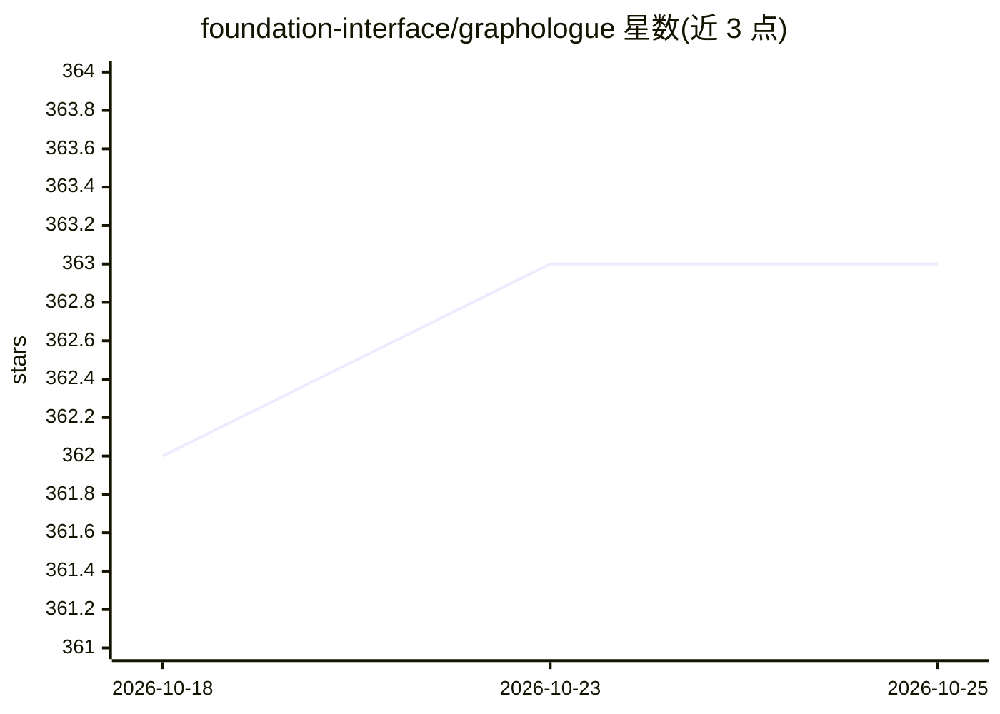

# foundation-interface/graphologue

⭐ 363 · TypeScript · MIT · 推送 2026-03-06 · [GitHub](https://github.com/foundation-interface/graphologue) · [官网](https://graphologue.app) · 组织维护

**把 LLM 回答实时转为可交互节点连线图的界面系统（UIST 2023）**

研究型交互系统（UIST 2023 论文，UC San Diego Creativity Lab）：通过提示策略与界面设计从 LLM（如 GPT-4）回答中抽取实体与关系，实时构建节点连线图并支持 Inline Annotation；用户可在图上调整呈现、发起上下文相关追问，形成图形化非线性对话。以 React 项目形式提供源码：npm install 安装依赖、配置 .env 中的 OpenAI API key、npm start 启动本地服务，另有在线 Demo（需自备 API key）。

## 筛选速览

| 维度 | 判定 | 备注 |
|---|---|---|
| AI 角色 | `ai-native` | 本体是模型或模型工具 |
| 许可风险 | `permissive` | MIT |
| 部署形态 | `library` | 以包/库形式分发 |
| 模型依赖 | — | README 未给出锁定关系 |
| 硬件要求 | — | 无带数字的原话,不猜 |
| 安装摩擦 | `low` | 无编译、无系统依赖或容器化 |
| 成熟度 | — | 结构信号不足 |

## 能力要点

- LLM 文本回答实时转换为节点连线交互图
- Inline Annotation 与图上上下文追问
- 基于形成性研究（10 名参与者）的学术系统，UIST 2023 发表

## 适用场景

- 阅读长篇 LLM 回答时以图形方式梳理实体关系
- 通过图交互向 LLM 发起针对性追问
- HCI/LLM 界面研究的参考实现与复现

## 场景标签

`聊天机器人` · 领域:对话与助手

## 证据(README 行号)

> L3: Graphologue transforms Large Language Model (LLM, such as GPT-4) responses into interactive diagrams in real-time wi
> L43: Large language models (LLMs) have recently soared in popularity due to their ease of access and the unprecedented a
> L47: This work would not be possible without the selfless and heartwarming support of all the members of the Creativity 

## 星数曲线

2026-10-18 362 → 2026-10-25 363（+1）

---
*卡片 v1 · prompt 1.4 · 生成 2026-10-22 · 置信度 high · 依据 README sha `cdf0fc4a141f` · [字段定义](../../DATASET.md)*
