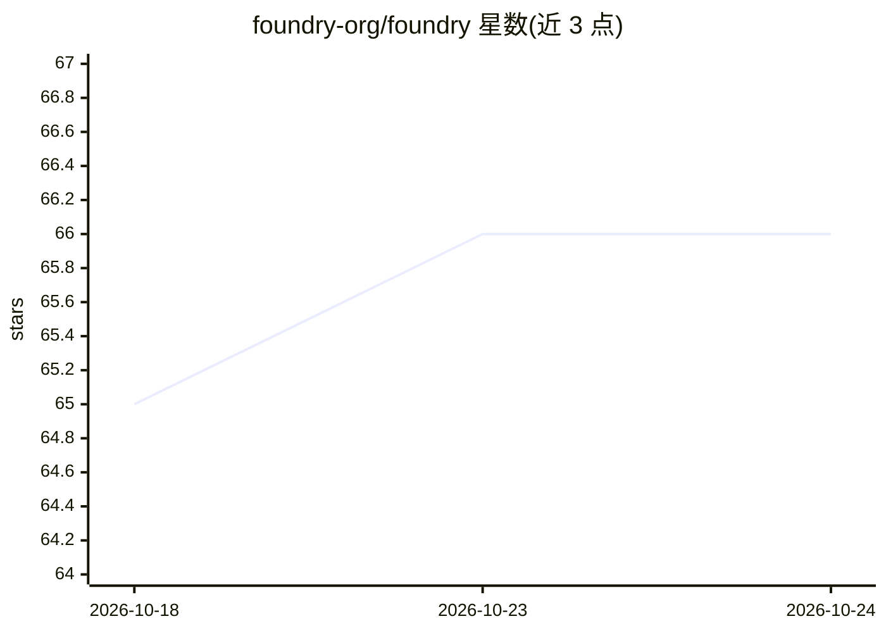

# foundry-org/foundry

⭐ 66 · C++ · Apache-2.0 · 推送 2026-10-22 · [GitHub](https://github.com/foundry-org/foundry) · [官网](https://arxiv.org/abs/2604.06664) · 组织维护

**CUDA 图持久化系统：让 LLM 推理引擎跳过预热秒级冷启动**

通过模板化上下文物化，把捕获的 CUDA 图的结构与执行上下文（内存布局、内核二进制、图模板）序列化到磁盘，LOAD 时重建相同的驱动侧状态，使 LLM serving 引擎可跳过 warmup 直接从磁盘恢复，数秒内启动。提供 SGLang、vLLM、TensorRT-LLM 集成代码与 recipe；通过拦截 CUDA 驱动调用实现确定性内存布局，恢复后的图以原生速度回放。要求 Linux x86_64、CUDA 12.0+ 的 NVIDIA 驱动，预编译 wheel 按 torch/CUDA 版本配对发布在 PyPI，也支持源码编译。

## 筛选速览

| 维度 | 判定 | 备注 |
|---|---|---|
| AI 角色 | `ai-ecosystem` | LLM/agent 周边工具 |
| 许可风险 | `permissive` | Apache-2.0 |
| 部署形态 | `library` | 以包/库形式分发 |
| 模型依赖 | local-ok | 支持本地模型 |
| 硬件要求 | — | 无带数字的原话,不猜 |
| 安装摩擦 | `high` | 编译与系统依赖俱全 |
| 成熟度 | — | 结构信号不足 |

## 能力要点

- CUDA 图 SAVE/LOAD 物化：恢复后以原生速度回放
- SGLang/vLLM/TensorRT-LLM 引擎集成（SGLang 单卡/DP/TP/EP 已端到端验证）
- SGLang 8×H100 上 256 张 decode 图恢复耗时 2-4 秒级，替代 30 秒以上的 warmup
- PyPI 预编译 wheel（foundry-core），按 torch/CUDA 版本配对分索引发布

## 适用场景

- 让 vLLM/SGLang 服务跳过冷启动预热快速上线
- 弹性伸缩场景下频繁拉起推理实例时缩短就绪时间
- 研究 CUDA 图捕获与恢复的确定性内存布局机制

## 场景标签

`推理引擎` · 领域:训练与推理

## 证据(README 行号)

> L10: With Foundry, LLM serving engines can directly reload CUDA states from disk and skip the warmup process to start in
> L36: ## Inference-Engine Integrations

## 星数曲线

2026-10-18 65 → 2026-10-24 66（+1）

---
*卡片 v1 · prompt 1.4 · 生成 2026-10-24 · 置信度 high · 依据 README sha `9c0bf42acb70` · [字段定义](../../DATASET.md)*
