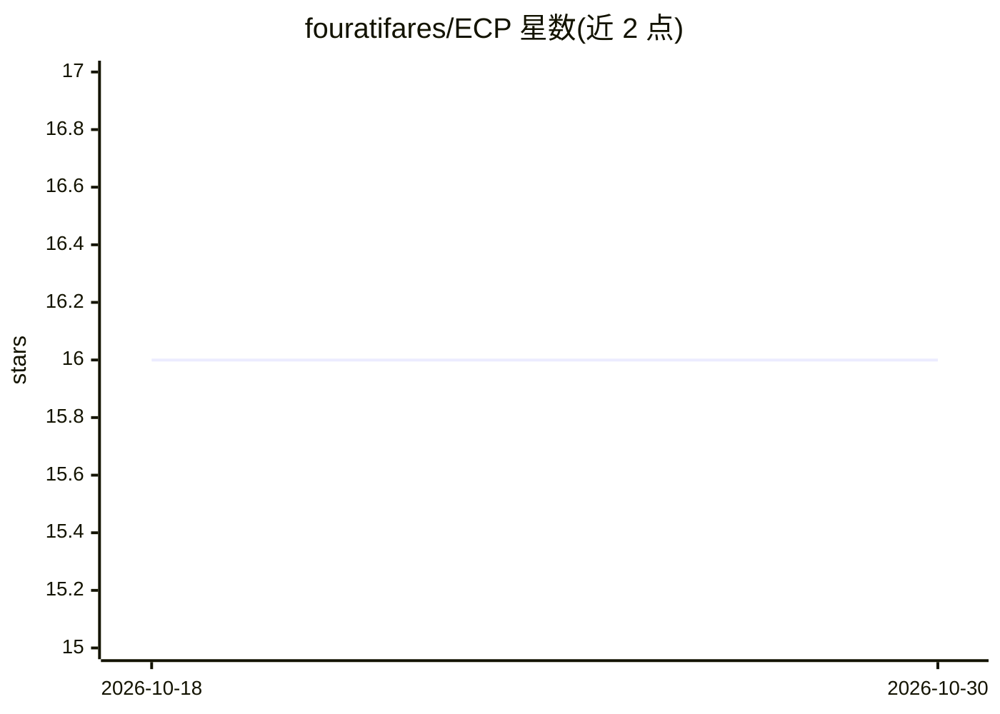

# fouratifares/ECP

⭐ 16 · Jupyter Notebook · MIT · 推送 2026-04-23 · [GitHub](https://github.com/fouratifares/ECP) · [官网](https://arxiv.org/abs/2502.04290) · 组织维护

**黑箱函数全局优化算法 ECP 的官方实现**

论文 Every Call is Precious 的算法实现：ECP 面向未知 Lipschitz 常数的非凸黑箱函数全局最大化，通过集中于潜在最优区域减少无价值评估，提供无遗憾保证与有限预算下的 minimax 最优遗憾界。以 Python 源码形式提供，git clone 后用命令行指定目标函数、评估次数与重复次数运行，附带 30 个多维非凸基准函数与 4 个 Google Colab 教程（含超参数优化与离散函数场景），支持自定义目标函数类。结果输出到 results/ 目录。

## 筛选速览

| 维度 | 判定 | 备注 |
|---|---|---|
| AI 角色 | `ai-native` | 本体是模型或模型工具 |
| 许可风险 | `permissive` | MIT |
| 部署形态 | `None` |  |
| 模型依赖 | — | README 未给出锁定关系 |
| 硬件要求 | — | 无带数字的原话,不猜 |
| 安装摩擦 | `low` | 无编译、无系统依赖或容器化 |
| 成熟度 | — | 结构信号不足 |

## 能力要点

- 无需估计 Lipschitz 常数的全局优化算法
- 无遗憾保证与有限预算下 minimax 最优遗憾界
- 内置 30 个多维非凸基准函数
- 4 个 Colab 教程，含超参数优化与离散函数场景

## 适用场景

- 我要对昂贵评估的黑箱目标函数做全局优化
- 用现成基准函数复现论文实验结果
- 把 ECP 用于机器学习超参数优化

## 场景标签

`教程课程` · 领域:学习与行业

## 证据(README 行号)

> L3: This repository implements **ECP** algorithm for solving non-convex black-box global optimization problems, as intro
> L7: ECP is a global optimization algorithm for maximization that **minimizes unpromising evaluations** by concentrating 
> L11: Empirical results show that ECP **outperforms 10 benchmark algorithms** including Lipschitz, Bayesian, bandits, and

## 星数曲线

2026-10-18 16 → 2026-10-30 16（+0）

---
*卡片 v1 · prompt 1.4 · 生成 2026-10-30 · 置信度 high · 依据 README sha `fef1fea0328d` · [字段定义](../../DATASET.md)*
