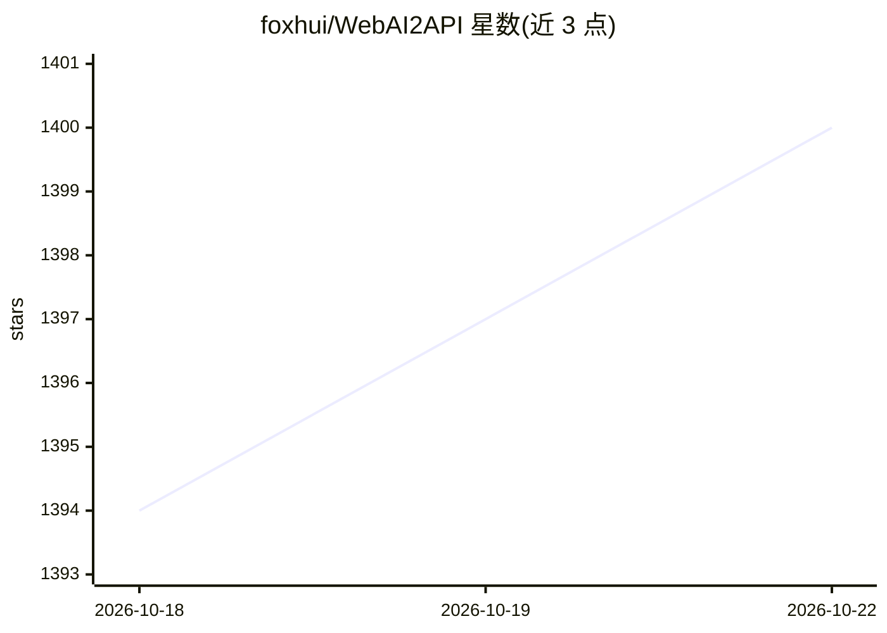

# foxhui/WebAI2API

⭐ 1,403 · JavaScript · MIT · 推送 2026-07-10 · [GitHub](https://github.com/foxhui/WebAI2API) · [官网](https://foxhui.github.io/WebAI2API/) · 个人维护 · 中文 README

**把 LMArena/Gemini 等网页 AI 转成 OpenAI 兼容 API 的工具**

基于 Camoufox(Playwright) 的网页版 AI 服务转 API 工具：模拟人类打字与鼠标轨迹操作 LMArena、Gemini、ChatGPT、DeepSeek、豆包等网站，对外提供 OpenAI 格式接口（/v1/chat/completions、/v1/models），支持流式响应与心跳保活、多窗口并发、多账号浏览器实例隔离与独立代理。提供 Web 管理界面（实时日志、VNC 连接、适配器管理），另有获取 Cookie 的接口。支持源码运行与 Docker 部署；README 免责声明仅供学习交流。

## 筛选速览

| 维度 | 判定 | 备注 |
|---|---|---|
| AI 角色 | `ai-ecosystem` | LLM/agent 周边工具 |
| 许可风险 | `permissive` | MIT |
| 部署形态 | `self-host` | docker 或自建部署 |
| 模型依赖 | locked-api |  |
| 硬件要求 | — | 无带数字的原话,不猜 |
| 安装摩擦 | `low` | 无编译、无系统依赖或容器化 |
| 成熟度 | — | 结构信号不足 |

## 能力要点

- OpenAI 兼容接口，支持流式响应与两种心跳保活模式
- 多窗口并发、多账号浏览器实例级数据隔离与独立代理
- 覆盖 LMArena/Gemini/ChatGPT/DeepSeek 等站点的文本/图片/视频生成
- Web 管理界面与 /v1/cookies 自动续登 Cookie 获取接口

## 适用场景

- 把已有账号的网页 AI 服务接入 OpenAI 格式的客户端工具
- 多账号并发调用网页 AI 的文本与图片生成
- 通过 Docker 在服务器上长期运行并远程管理

## 场景标签

`浏览器自动化` `模型网关` `图像生成` · 领域:Agent 开发

## 证据(README 行号)

> L11: **WebAI2API** 是一个基于 **Camoufox (Playwright)** 的网页版 AI 服务转通用 API 的工具。通过模拟人类操作与 LMArena、Gemini 等网站交互, 提供兼容 **OpenAI 格
> L16: - 🔄 **接口兼容**: 提供标准 OpenAI 格式接口, 支持流式响应与心跳保活

## 星数曲线

2026-10-18 1,394 → 2026-10-22 1,400（+6）

---
*卡片 v1 · prompt 1.4 · 生成 2026-10-21 · 置信度 mid · 依据 README sha `69a675d5e39c` · [字段定义](../../DATASET.md)*
