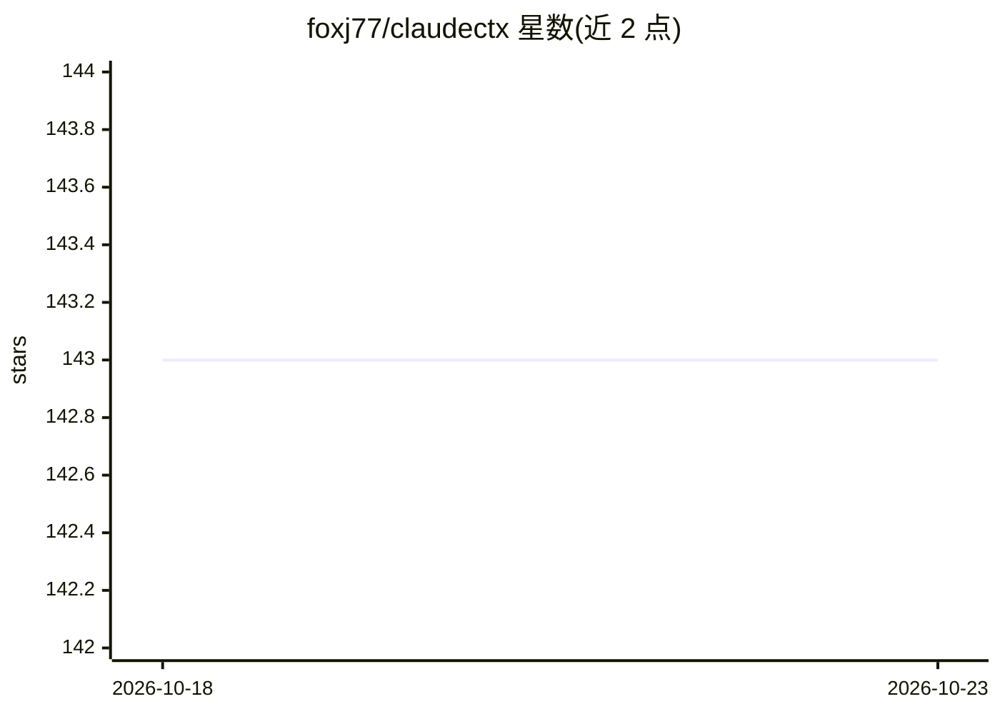

# foxj77/claudectx

⭐ 143 · Go · MIT · 推送 2026-10-19 · [GitHub](https://github.com/foxj77/claudectx) · 个人维护

**Claude Code 配置切换 CLI：一条命令切换多套配置档案**

命令行工具，管理 Claude Code 的多套配置档案（profile）：一条命令切换 settings.json、CLAUDE.md、模型偏好、环境变量、工具权限与 MCP 服务器配置。提供两种模式：持久切换（自动备份、校验、失败回滚）与会话式 run（仅当前终端生效，不改全局配置，支持多会话并行）。支持配置导出/导入用于团队共享，通过 Homebrew、源码编译或预编译二进制安装。认证与项目级配置不在切换范围内。

## 筛选速览

| 维度 | 判定 | 备注 |
|---|---|---|
| AI 角色 | `ai-ecosystem` | LLM/agent 周边工具 |
| 许可风险 | `permissive` | MIT |
| 部署形态 | `desktop` | 安装包/桌面程序 |
| 模型依赖 | — | README 未给出锁定关系 |
| 硬件要求 | — | 无带数字的原话,不猜 |
| 安装摩擦 | `medium` | 含编译或系统依赖之一 |
| 成熟度 | — | 结构信号不足 |

## 能力要点

- 一条命令切换 settings.json/CLAUDE.md/MCP 等整套配置
- 每次切换自动备份、校验并在失败时回滚
- run 模式按会话启动 Claude Code，不改全局配置，支持并行会话
- profile 可导出/导入 JSON，用于团队共享与跨机器迁移

## 适用场景

- 在工作和个人 Claude 账户/配置间快速切换
- 为不同客户维护并即时切换各自配置
- 同时打开使用不同配置的多个 Claude Code 会话
- 团队间共享标准化配置档案

## 场景标签

 · 领域:开发工具/LLM 客户端配置管理

## 证据(README 行号)

> L13: **The Solution:** `claudectx` lets you switch your entire Claude Code configuration with a single command. No more 
> L43: claudectx is a command-line tool that lets you quickly switch between different Claude Code configurations. Think o

## 星数曲线

2026-10-18 143 → 2026-10-23 143（+0）

---
*卡片 v1 · prompt 1.4 · 生成 2026-10-22 · 置信度 high · 依据 README sha `1bb66580c1a1` · [字段定义](../../DATASET.md)*
