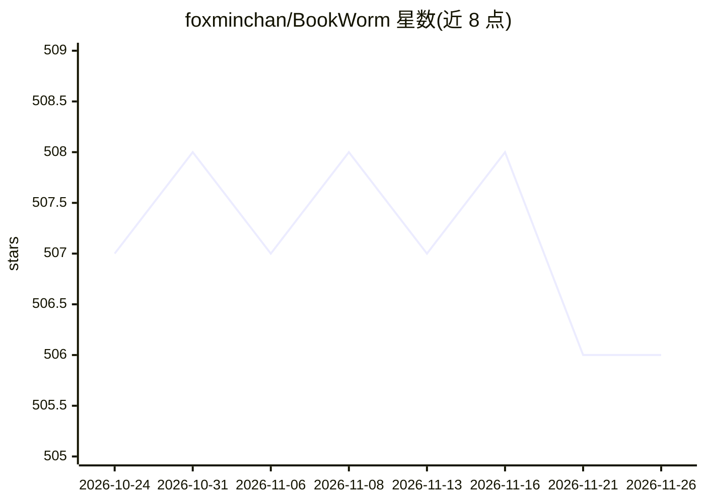

# foxminchan/BookWorm

⭐ 506 · C# · MIT · 推送 2026-11-24 · [GitHub](https://github.com/foxminchan/BookWorm) · [官网](https://foxminchan.github.io/BookWorm/) · 个人维护

**.NET Aspire 多智能体微服务参考架构（演示用途）**

BookWorm 是一个以 Aspire 构建的云原生参考架构项目，展示微服务与微前端下的 AI 集成方式。后端采用 DDD、VSA 与 CQRS，实现 outbox/inbox、saga、事件溯源、gRPC 服务通信、FusionCache 缓存及 Microsoft Entra ID 认证；AI 部分使用 Microsoft Foundry 提供 LLM 与嵌入，Agent Framework 编排多智能体工作流，并通过 MCP、A2A、AG-UI、A2UI 协议标准化工具与交互。README 明确声明项目仅供演示、非生产就绪。

## 筛选速览

| 维度 | 判定 | 备注 |
|---|---|---|
| AI 角色 | `ai-ecosystem` | LLM/agent 周边工具 |
| 许可风险 | `permissive` | MIT |
| 部署形态 | `None` |  |
| 模型依赖 | — | README 未给出锁定关系 |
| 硬件要求 | — | 无带数字的原话,不猜 |
| 安装摩擦 | `low` | 无编译、无系统依赖或容器化 |
| 成熟度 | — | 结构信号不足 |

## 能力要点

- 基于 Aspire 的微服务架构，含 outbox/inbox、saga、事件溯源等模式
- Agent Framework 编排多智能体工作流，MCP 标准化 AI 工具接入
- 支持 A2A、AG-UI、A2UI 协议的智能体通信与交互式 UI 生成
- Next.js 多区域微前端店面与管理后台

## 适用场景

- 参考其架构搭建 .NET 微服务 + 多智能体应用
- 学习 MCP/A2A/AG-UI 等协议在微服务中的集成方式
- 作为 DDD、CQRS、事件溯源等模式的教学示例工程

## 场景标签

`多智能体` · 领域:Agent 开发

## 证据(README 行号)

> L23:  ⭐ BookWorm showcases Aspire in a cloud-native application with AI integration. Built with DDD and VSA, it features
> L47:  - [x] Orchestrated multi-agent workflows using Agent Framework

## 星数曲线

2026-10-24 507 → 2026-11-26 506（-1）

---
*卡片 v1 · prompt 1.4 · 生成 2026-11-25 · 置信度 high · 依据 README sha `ef1580c43843` · [字段定义](../../DATASET.md)*
