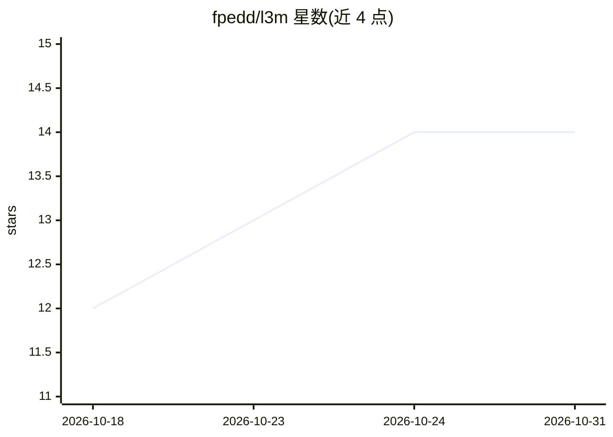

# fpedd/l3m

⭐ 14 · C · MIT · 推送 2026-09-29 · [GitHub](https://github.com/fpedd/l3m) · 个人维护

**将小语言模型常驻 CPU 缓存进行推理的极简引擎，供开发者本地高速生成文本**

用 C11 编写的最小推理引擎：将权重矩阵按核分片，使小语言模型完全驻留在 CPU 的 L2/L3 缓存中，逐 token 从缓存流式读取权重，从而绕过 DRAM 带宽瓶颈；对能装进缓存的模型，token 生成速度为同核 llama.cpp 的 3-5 倍。运行于 Linux、x86-64 且支持 AVX2 的 CPU。提供命令行工具与 Python 模块，内置 stories15M 与 SmolLM2-135M 等模型规格；加载器会拒绝超出缓存预算的模型，可通过 --ctx 缩小 KV 缓存或 --force 强制加载。速度优势随模型超出缓存而减小。面向本地推理实验与嵌入式/低带宽场景的开发者。

## 筛选速览

| 维度 | 判定 | 备注 |
|---|---|---|
| AI 角色 | `ai-ecosystem` | LLM/agent 周边工具 |
| 许可风险 | `permissive` | MIT |
| 部署形态 | `None` |  |
| 模型依赖 | — | README 未给出锁定关系 |
| 硬件要求 | — | 无带数字的原话,不猜 |
| 安装摩擦 | `low` | 无编译、无系统依赖或容器化 |
| 成熟度 | — | 结构信号不足 |

## 能力要点

- 权重按核分片常驻 CPU L2/L3 缓存，模型不触 DRAM
- 对可装入缓存的模型，token 生成速度为同核 llama.cpp 的 3-5 倍
- 加载器拒绝超出缓存预算的模型；./l3m hw 查看各核预算、./l3m check 对照 fp32 参考校验输出
- 提供 CLI 与 Python API，支持 HF 权重导出为 .l3m 格式（bf16/q8_0/q4_0）

## 适用场景

- 在桌面 CPU 上高速运行百万级参数的小语言模型
- 研究缓存驻留推理架构并与 llama.cpp 做基准对比
- 通过 Python API 在本地嵌入式/低内存带宽环境生成文本

## 场景标签

`推理引擎` · 领域:训练与推理

## 证据(README 行号)

> L9: l3m is a minimal inference engine that keeps small language models entirely in CPU cache.
> L14: runs 3 to 5 times faster than llama.cpp on the same cores. l3m runs on Linux, on x86-64 CPUs with AVX2.

## 星数曲线

2026-10-18 12 → 2026-10-31 14（+2）

---
*卡片 v1 · prompt 1.4 · 生成 2026-10-31 · 置信度 high · 依据 README sha `2dcbb4775968` · [字段定义](../../DATASET.md)*
