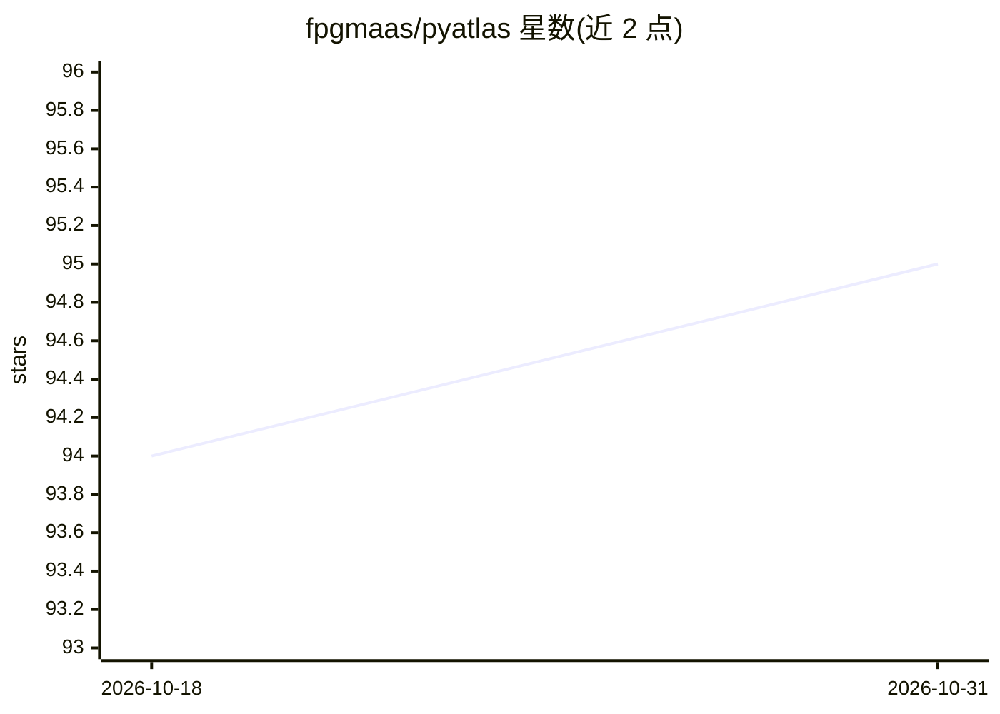

# fpgmaas/pyatlas

⭐ 95 · TypeScript · Apache-2.0 · 推送 2026-03-18 · [GitHub](https://github.com/fpgmaas/pyatlas) · [官网](https://fpgmaas.github.io/pyatlas/) · 个人维护

**PyPI 前 1 万 Python 包的交互式向量嵌入地图**

采集 PyPI 最流行包的描述，用 Sentence Transformers 生成向量嵌入，经 UMAP 降维与 HDBSCAN 聚类后生成 2D 坐标，形成功能相似的包在空间上相邻的交互式地图；聚类标签由 OpenAI gpt-5-mini 生成。前端用 React 与 Three.js 呈现，数据源为 Google BigQuery 上的 PyPI 数据集。作者自述为技术演示与爱好项目，可用于发现相似或相关 Python 包。

## 筛选速览

| 维度 | 判定 | 备注 |
|---|---|---|
| AI 角色 | `ai-knowledge` | 知识聚合/清单类 |
| 许可风险 | `permissive` | Apache-2.0 |
| 部署形态 | `library` | 以包/库形式分发 |
| 模型依赖 | — | README 未给出锁定关系 |
| 硬件要求 | — | 无带数字的原话,不猜 |
| 安装摩擦 | `low` | 无编译、无系统依赖或容器化 |
| 成熟度 | `idea` | |

## 能力要点

- 覆盖 PyPI 前 10,000 包的交互式可视化地图
- Sentence Transformers 嵌入 + UMAP 降维 + HDBSCAN 聚类流水线
- 聚类标签由 OpenAI gpt-5-mini 生成
- 数据来自 Google BigQuery 的 PyPI 数据集，SQL 查询公开

## 适用场景

- 我想找与 matplotlib 功能相似的 Python 包
- 浏览 Python 包生态的整体分布与聚类结构
- 发现相关工具或替代库

## 场景标签

 · 领域:开发者工具/数据可视化

## 证据(README 行号)

> L11: PyAtlas is an interactive map of the top 10,000 Python packages on PyPI. Packages with similar functionality are po
> L15: The project collects descriptions for the most popular packages on PyPI. These descriptions are converted into vect

## 星数曲线

2026-10-18 94 → 2026-10-31 95（+1）

---
*卡片 v1 · prompt 1.4 · 生成 2026-10-23 · 置信度 mid · 依据 README sha `efc5c57ca92c` · [字段定义](../../DATASET.md)*
