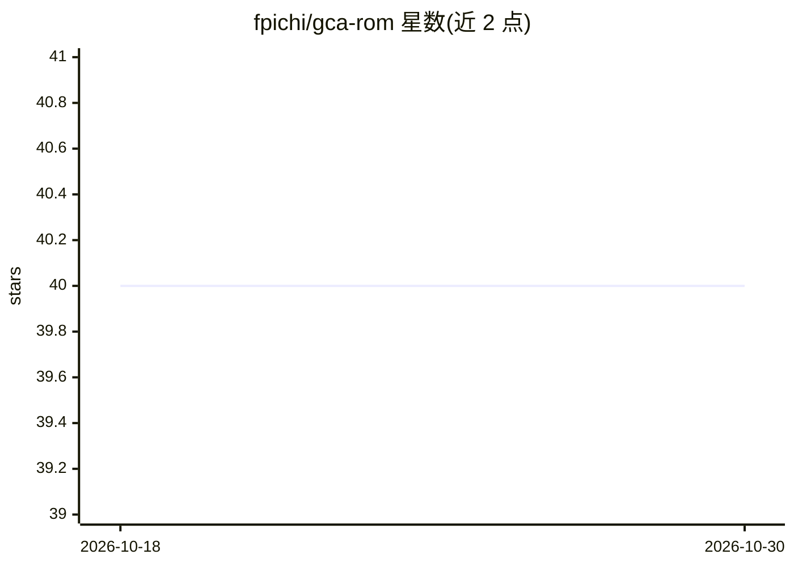

# fpichi/gca-rom

⭐ 40 · Jupyter Notebook · GPL-3.0 · 推送 2026-05-15 · [GitHub](https://github.com/fpichi/gca-rom) · [官网](https://fpichi.github.io/gca-rom/) · 组织维护

**科研用图卷积自编码器库，做参数化 PDE 的非线性降阶**

实现图卷积自编码器架构的 Python 库，用于参数化偏微分方程的非线性模型降阶：图结构表达非结构网格数据，编码器经 MoNet 空间卷积、跳跃连接、池化与瓶颈得到低维潜变量，解码器逆向重建解场。提供离线训练与在线预测两阶段流程，含 14 个基准教程（Poisson、Navier-Stokes、弹性等），可在 Google Colab 运行，训练后自动生成误差与损失图。依赖 pytorch、pyg、h5py 等，附 conda 环境配置文件。面向计算力学与科学机器学习研究者。

## 筛选速览

| 维度 | 判定 | 备注 |
|---|---|---|
| AI 角色 | `ai-native` | 本体是模型或模型工具 |
| 许可风险 | `viral` | GPL-3.0 |
| 部署形态 | `None` |  |
| 模型依赖 | — | README 未给出锁定关系 |
| 硬件要求 | — | 无带数字的原话,不猜 |
| 安装摩擦 | `low` | 无编译、无系统依赖或容器化 |
| 成熟度 | — | 结构信号不足 |

## 能力要点

- 图卷积自编码器架构（MoNet 空间卷积/跳跃连接/池化/瓶颈）
- 离线-在线两阶段的非线性模型降阶流程
- 14 个参数化 PDE 基准教程，支持标量/矢量、线性和非线性方程
- 训练后自动生成损失、误差场与动态 gif 等可视化

## 适用场景

- 对非结构网格上的参数化 PDE 解做降阶近似
- 复现 Poisson、Graetz、Navier-Stokes 等降阶基准
- 在 Google Colab 中无需本地安装即可运行教程

## 场景标签

`教程课程` · 领域:学习与行业

## 证据(README 行号)

> L3: GCA-ROM is a library which implements graph convolutional autoencoder architecture as a nonlinear model order reduct
> L56: The nonlinear ROM methodology has been tested on 14 different benchmarks, including:

## 星数曲线

2026-10-18 40 → 2026-10-30 40（+0）

---
*卡片 v1 · prompt 1.4 · 生成 2026-10-25 · 置信度 high · 依据 README sha `775d3ae18294` · [字段定义](../../DATASET.md)*
