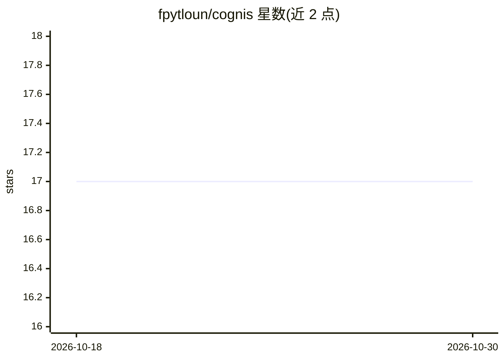

# fpytloun/cognis

⭐ 17 · Python · NOASSERTION · 推送 2026-10-24 · [GitHub](https://github.com/fpytloun/cognis) · 个人维护

**自托管 Agent OS：构建、对话、委派与安全执行 AI 代理工作**

Cognis 是自托管的云原生 Agent 操作系统，采用 controller/executors 分离架构：控制器管理用户、代理、对话、工作流、记忆上下文、guardrails 与 UI；执行器在本地或云端运行工具、浏览器、shell、LSP 与 MCP 服务器。功能包括流式聊天工作台、任务与工作流、审批门、版本化技能、Qdrant 知识库、OpenAI 兼容推理路由、PWA 移动端。需搭配伴生服务 Mnemory（记忆）与 Intaris（护栏/审计），无配置文件，通过环境变量与 UI/API 管理。

## 筛选速览

| 维度 | 判定 | 备注 |
|---|---|---|
| AI 角色 | `ai-ecosystem` | LLM/agent 周边工具 |
| 许可风险 | `none` | NOASSERTION |
| 部署形态 | `self-host` | docker 或自建部署 |
| 模型依赖 | local-ok | 支持本地模型 |
| 硬件要求 | — | 无带数字的原话,不猜 |
| 安装摩擦 | `low` | 无编译、无系统依赖或容器化 |
| 成熟度 | — | 结构信号不足 |

## 能力要点

- controller/executors 分离架构，工具在本地、私有网络或云端执行
- 任务/工作流含依赖、审批门、交付物与计划调度
- Playwright/Patchright 浏览器自动化与 MCP 工具集成
- Mnemory 长期记忆与 Intaris 护栏、审计、审批

## 适用场景

- 搭建带聊天、浏览器自动化与定时工作流的个人代理工作台
- 团队部署控制器并跨网络接入远程执行器
- 需要人工审批门与审计轨迹的可复现代理任务运营

## 场景标签

`Agent 框架` `浏览器自动化` `工作流自动化` · 领域:Agent 开发

## 证据(README 行号)

> L12: Cognis separates the **controller** from **executors**. The controller is the brain: it owns users, agents, convers
> L111: The important rule is simple: **the controller decides, executors do**. Even local development uses the same conce

## 星数曲线

2026-10-18 17 → 2026-10-30 17（+0）

---
*卡片 v1 · prompt 1.4 · 生成 2026-10-29 · 置信度 high · 依据 README sha `c95b851543a5` · [字段定义](../../DATASET.md)*
