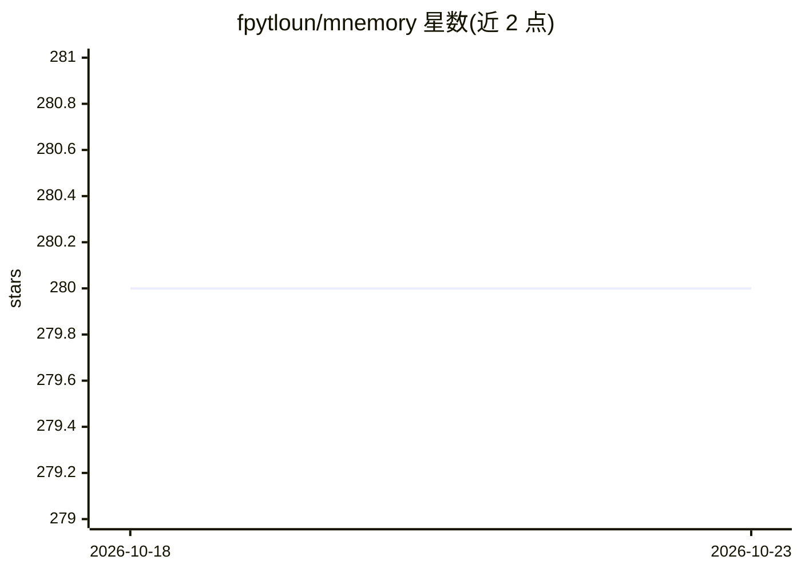

# fpytloun/mnemory

⭐ 280 · Python · NOASSERTION · 推送 2026-10-21 · [GitHub](https://github.com/fpytloun/mnemory) · 个人维护

**给 AI agent 提供自托管长期记忆的 MCP 服务器**

自托管的 MCP 服务器，为 Claude Code、ChatGPT、Cursor 等 MCP 兼容客户端增加持久记忆与个性化能力：用单次 LLM 调用完成事实抽取、分类、去重与矛盾消解，两层结构（向量库摘要 + S3/MinIO 工件存储）配合多查询语义检索与时间感知。附带管理 UI、三阶段健康检查（fsck）、16 个 MCP 工具与 REST 双接口、Prometheus 监控。需要 OpenAI 兼容 API key 运行；删除为尽力而为，非合规级擦除保证。LoCoMo 基准总体 73.2。

## 筛选速览

| 维度 | 判定 | 备注 |
|---|---|---|
| AI 角色 | `ai-ecosystem` | LLM/agent 周边工具 |
| 许可风险 | `none` | NOASSERTION |
| 部署形态 | `None` |  |
| 模型依赖 | — | README 未给出锁定关系 |
| 硬件要求 | — | 无带数字的原话,不猜 |
| 安装摩擦 | `low` | 无编译、无系统依赖或容器化 |
| 成熟度 | — | 结构信号不足 |

## 能力要点

- 单次 LLM 调用完成事实抽取、分类、去重与矛盾消解
- 两层记忆：向量库摘要 + 按需取回的工件存储
- 三阶段健康检查（fsck）检测重复、矛盾与提示注入
- 16 个 MCP 工具 + REST API 双接口，Qdrant/S3 生产部署

## 适用场景

- 让我的 AI 助手跨对话记住偏好、事实与决定
- 为生产环境 agent 部署自托管记忆层
- 审计与修复积累的记忆（去重、矛盾、质量）

## 场景标签

`Agent 记忆` · 领域:Agent 开发

## 证据(README 行号)

> L9: Give your AI agents persistent memory. mnemory is a self-hosted MCP server that adds personalization and long-term m
> L29: - **REST API + MCP** — Dual interface with the same backend. 16 MCP tools + full REST API with OpenAPI spec. Build 

## 星数曲线

2026-10-18 280 → 2026-10-23 280（+0）

---
*卡片 v1 · prompt 1.4 · 生成 2026-10-22 · 置信度 high · 依据 README sha `680450dbd42c` · [字段定义](../../DATASET.md)*
