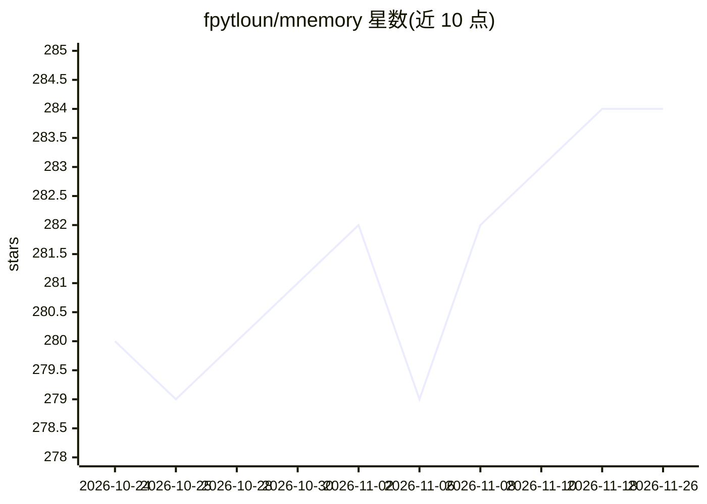

# fpytloun/mnemory

⭐ 284 · Python · NOASSERTION · 推送 2026-11-22 · [GitHub](https://github.com/fpytloun/mnemory) · 个人维护

**给 AI agent 提供自托管长期记忆的 MCP 服务器**

自托管的 MCP 服务器，为 AI 助手与 agent 添加持久化长期记忆：单次 LLM 调用完成事实抽取、元数据分类、去重与矛盾解决，记忆以向量形式语义可检索，并支持两级存储（向量摘要 + S3/MinIO 工件）。提供 16 个 MCP 工具与 REST API 双接口、管理 UI、健康检查、TTL 过期机制与 Prometheus 监控。需 OpenAI 兼容 API key 运行；删除为 best effort，非合规级擦除。Apache 2.0 许可。

## 筛选速览

| 维度 | 判定 | 备注 |
|---|---|---|
| AI 角色 | `ai-ecosystem` | LLM/agent 周边工具 |
| 许可风险 | `none` | NOASSERTION |
| 部署形态 | `None` |  |
| 模型依赖 | — | README 未给出锁定关系 |
| 硬件要求 | — | 无带数字的原话,不猜 |
| 安装摩擦 | `low` | 无编译、无系统依赖或容器化 |
| 成熟度 | — | 结构信号不足 |

## 能力要点

- 单次 LLM 调用完成事实抽取、分类与去重，矛盾自动更新
- 两级记忆：向量摘要 + S3/MinIO 工件按需取回
- 16 个 MCP 工具 + REST API（OpenAPI spec）双接口
- 内置管理 UI、三阶段健康检查与 Prometheus/Grafana 监控

## 适用场景

- 让 Claude Code / Cursor 等客户端跨会话记住用户偏好与决策
- 自托管部署，记忆数据不出自有基础设施
- 团队级 agent 记忆隔离与运维监控（Kubernetes/Prometheus）

## 场景标签

`Agent 记忆` · 领域:Agent 开发

## 证据(README 行号)

> L15: Give your AI agents persistent memory. mnemory is a self-hosted MCP server that adds personalization and long-term 
> L33: - **Production ready** — Qdrant for vectors, S3/MinIO for artifacts, API key or Cognis JWT authentication, per-user

## 星数曲线

2026-10-24 280 → 2026-11-26 284（+4）

---
*卡片 v1 · prompt 1.4 · 生成 2026-11-25 · 置信度 high · 依据 README sha `71b9b5e5812c` · [字段定义](../../DATASET.md)*
