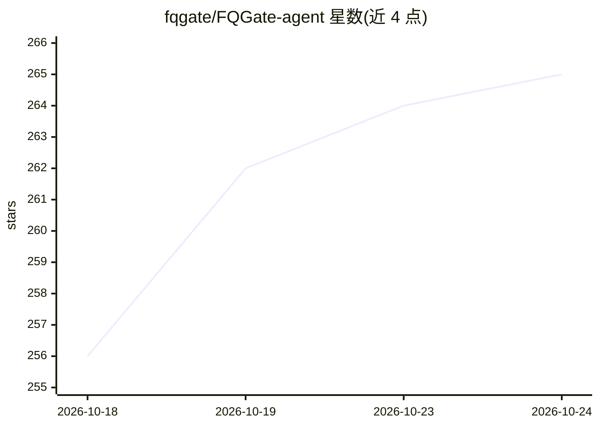

# fqgate/FQGate-agent

⭐ 265 · TypeScript · AGPL-3.0 · 推送 2026-10-12 · [GitHub](https://github.com/fqgate/FQGate-agent) · 个人维护 · 中文 README

**让 Codex/Claude Code 等 AI 工具接入本机 A 股行情的插件层**

FQGate Agent 是 FQGate 本地金融网关的开源 AI 接入项目：维护 Codex 与 Claude Code 插件入口、四个证券研究 Skill 和 MCP Apps 界面源码，向 AI 工具提供本机 A 股实时行情、K 线、Level-2、资讯与自选股数据；豆包、千问、DeepSeek Harness 等接入方式标注为开发测试中。行情由本机运行的 FQGate 主程序（需 2.0.0 以上，单独提供编译包）提供，默认仅监听 127.0.0.1:17281。明确不提供持仓查询与证券交易。插件源码 AGPL-3.0-only，由独立开发者维护。

## 筛选速览

| 维度 | 判定 | 备注 |
|---|---|---|
| AI 角色 | `ai-ecosystem` | LLM/agent 周边工具 |
| 许可风险 | `viral` | AGPL-3.0 |
| 部署形态 | `desktop` | 安装包/桌面程序 |
| 模型依赖 | locked-api |  |
| 硬件要求 | — | 无带数字的原话,不猜 |
| 安装摩擦 | `low` | 无编译、无系统依赖或容器化 |
| 成熟度 | `idea` | |

## 能力要点

- Codex 与 Claude Code 插件入口与四个证券研究 Skill
- 统一 Level-2 数据接口（逐笔成交/逐笔委托/撤单）
- 本机网关默认只监听 127.0.0.1:17281，单实例可服务多个 AI 工具
- 安装提供 SHA-256 校验并要求真实行情查询验证

## 适用场景

- 在 Claude Code/Codex 中直接查询 A 股实时行情与 K 线
- 通过 AI 助手汇总个股公告、资讯与 Level-2 盘口数据
- 用条件选股、事件研究等 Skill 辅助证券研究

## 场景标签

`金融量化` · 领域:学习与行业

## 证据(README 行号)

> L15: FQGate Agent 是 FQGate 的开源 AI 接入项目，维护 Codex 与 Claude Code 插件入口、四个证券研究 Skill 和 MCP Apps 界面源码。WorkBuddy、ZCode、OpenClaw
> L17: > 面向 AI 智能体的金融行情数据 MCP 终端
> L36: - **实时更新：** 由正在运行的 FQGate 获取行情，并通过查询或实时订阅接口提供给 AI 工具。

## 星数曲线

2026-10-18 256 → 2026-10-24 265（+9）

---
*卡片 v1 · prompt 1.4 · 生成 2026-10-22 · 置信度 high · 依据 README sha `22f25b66d3f2` · [字段定义](../../DATASET.md)*
