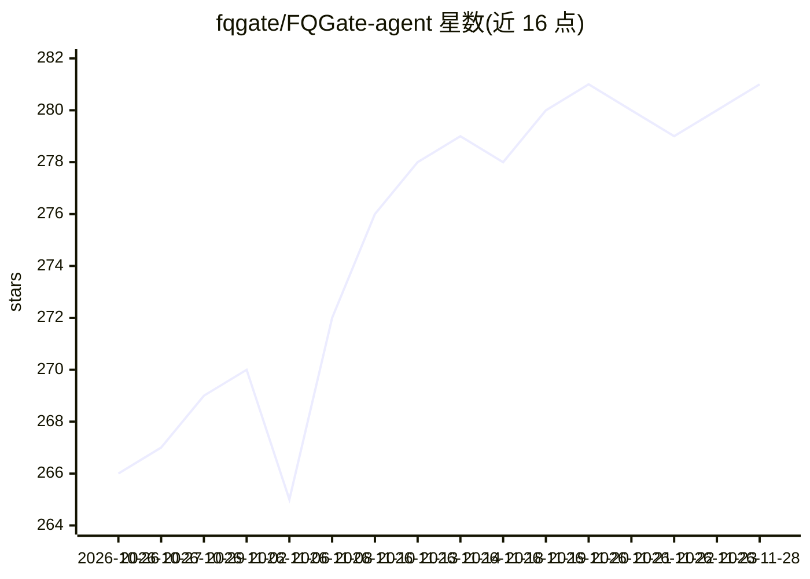

# fqgate/FQGate-agent

⭐ 281 · TypeScript · AGPL-3.0 · 推送 2026-11-04 · [GitHub](https://github.com/fqgate/FQGate-agent) · 个人维护 · 中文 README

**让 Codex/Claude Code 等 AI 工具接入本机 A 股行情与 Level-2 数据的 MCP 网关**

FQGate Agent 是 FQGate 本机行情网关的开源 AI 接入层，维护 Codex 与 Claude Code 插件入口、四个证券研究 Skill 和 MCP Apps 界面源码。FQGate 主程序监听 127.0.0.1:17281，从本地运行的实例获取实时行情、K 线、Level-2 逐笔数据与资讯，经统一 V2 接口以 MCP 工具形式提供给 AI 工具，一个实例可同时服务多个 AI 软件。安装方式为按操作系统下载正式编译包并核对 SHA-256，再在 AI 软件“AI 接入”页面或命令行安装插件完成接入；主程序编译包许可独立于 AGPL-3.0 开源部分，且不含交易功能。

## 筛选速览

| 维度 | 判定 | 备注 |
|---|---|---|
| AI 角色 | `ai-ecosystem` | LLM/agent 周边工具 |
| 许可风险 | `viral` | AGPL-3.0 |
| 部署形态 | `desktop` | 安装包/桌面程序 |
| 模型依赖 | — | README 未给出锁定关系 |
| 硬件要求 | — | 无带数字的原话,不猜 |
| 安装摩擦 | `low` | 无编译、无系统依赖或容器化 |
| 成熟度 | — | 结构信号不足 |

## 能力要点

- 提供统一 Level-2 接口，含逐笔成交、逐笔委托和撤单等实时数据
- 默认仅监听 127.0.0.1:17281，Agent 不连接公网或局域网地址
- 一个 FQGate 实例可同时服务多个 AI 工具，减少重复登录与初始化
- 支持四个证券研究 Skill（实时行情、条件选股、盘口成交、事件研究）

## 适用场景

- 在 Claude Code / Codex 会话中查询 A 股实时行情和日 K 线
- 查看个股分时、盘口和 Level-2 逐笔成交数据
- 汇总公司公告与市场资讯并标注信息时间
- 通过条件选股与事件研究 Skill 辅助证券研究流程

## 场景标签

`金融量化` · 领域:学习与行业

## 证据(README 行号)

> L5:  面向多种 AI 软件的开源 FQGate 接入层
> L15: FQGate Agent 是 FQGate 的开源 AI 接入项目，维护 Codex 与 Claude Code 插件入口、四个证券研究 Skill 和 MCP Apps 界面源码。WorkBuddy、ZCode、OpenClaw
> L36: - **实时更新：** 由正在运行的 FQGate 获取行情，并通过查询或实时订阅接口提供给 AI 工具。

## 星数曲线

2026-10-26 266 → 2026-11-28 281（+15）

---
*卡片 v1 · prompt 1.4 · 生成 2026-11-25 · 置信度 high · 依据 README sha `5d5832d6c82c` · [字段定义](../../DATASET.md)*
