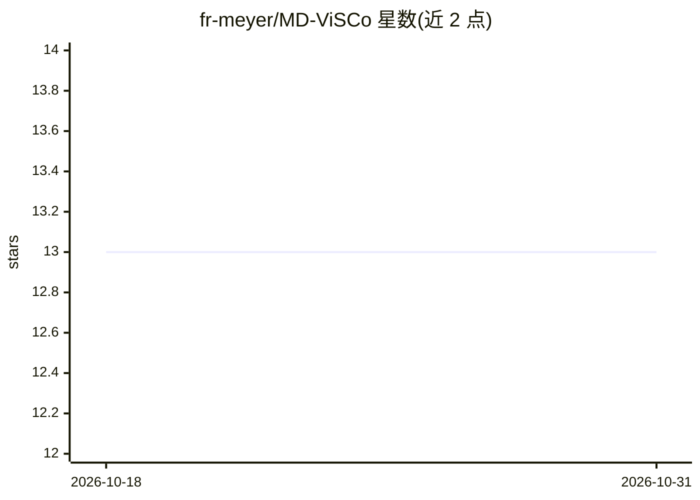

# fr-meyer/MD-ViSCo

⭐ 13 · Python · MIT · 推送 2026-04-17 · [GitHub](https://github.com/fr-meyer/MD-ViSCo) · [官网](https://ieeexplore.ieee.org/document/11366001) · 组织维护

**生命体征波形多向转换的深度学习框架（ECG/PPG/ABP）**

用单一模型在 ECG、PPG、ABP、IMP 波形之间做多向转换的深度学习框架：1D U-Net 结合 Swin Transformer，经 AdaIN 做波形风格自适应，并通过文本嵌入融合患者人口统计学信息（仅 PulseDB）。另支持血压标量预测、房颤分类、生理特征提取，并内置 NABNet、PatchTST、PPG2ABP、P2E-WGAN、WaveNet 多个基线实现。基于 PyTorch + Hydra 配置管理，通过 conda 环境与 torchrun 命令训练/评估，面向使用 PulseDB、UCI、MIMIC PERform 等数据集的研究人员。发表于 IEEE JBHI (2026)，MIT 许可。

## 筛选速览

| 维度 | 判定 | 备注 |
|---|---|---|
| AI 角色 | `ai-native` | 本体是模型或模型工具 |
| 许可风险 | `permissive` | MIT |
| 部署形态 | `None` |  |
| 模型依赖 | — | README 未给出锁定关系 |
| 硬件要求 | `cpu-ok` | |
| 安装摩擦 | `medium` | 含编译或系统依赖之一 |
| 成熟度 | — | 结构信号不足 |

## 能力要点

- ECG/PPG/ABP/IMP 波形间多向转换的统一模型架构
- 人口统计学信息经文本嵌入融合（仅 PulseDB 数据集）
- 附 NABNet/PatchTST/PPG2ABP/P2E-WGAN/WaveNet 多个基线实现
- 支持血压预测（SBP/DBP）与基于 ECG 的房颤分类

## 适用场景

- 研究 PPG/ECG 到 ABP 波形的转换与无袖带血压估计
- 在 PulseDB/UCI/MIMIC PERform 数据集上复现或对比基线模型
- 从生理波形中提取 ECG/PPG 特征做生理分析

## 场景标签

 · 领域:生物医学信号处理

## 证据(README 行号)

> L8: MD-ViSCo is a unified deep learning framework for converting vital sign waveforms (ECG, PPG, ABP) using a single mod
> L20: - **Blood pressure estimation** from PPG/ECG signals

## 星数曲线

2026-10-18 13 → 2026-10-31 13（+0）

---
*卡片 v1 · prompt 1.4 · 生成 2026-10-31 · 置信度 high · 依据 README sha `aaf01bbdeb38` · [字段定义](../../DATASET.md)*
