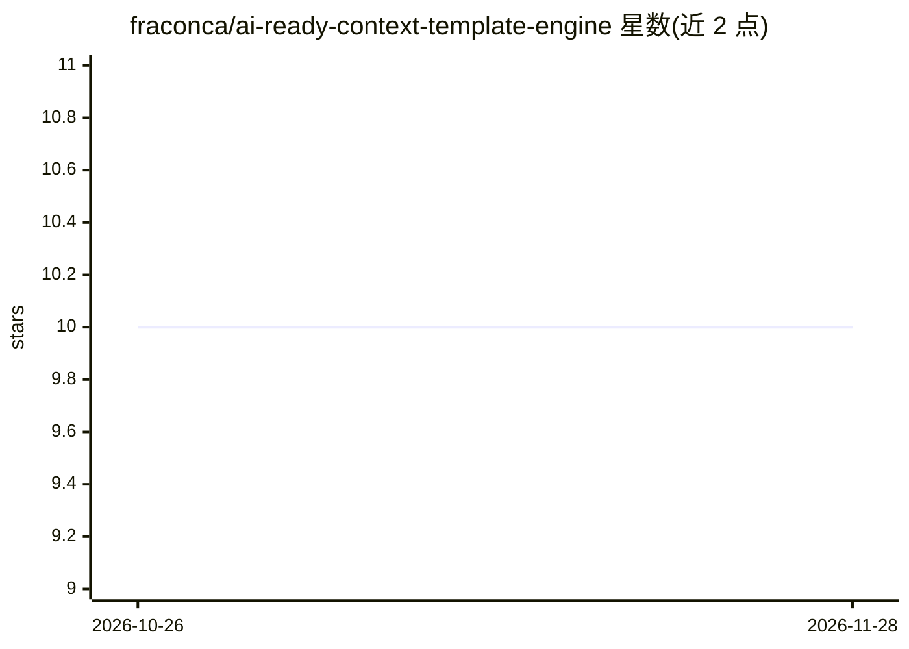

# fraconca/ai-ready-context-template-engine

⭐ 10 · Shell · MIT · 推送 2026-07-27 · [GitHub](https://github.com/fraconca/ai-ready-context-template-engine) · 个人维护

**为 AI 辅助开发生成标准化项目工作区结构的模板生成器**

一个项目工作区模板生成器：通过远程脚本在本地初始化包含 `llms.txt` 索引与 `.ai/` 上下文目录的仓库结构，内置 10 种技术栈（静态 HTML、Next.js、FastAPI/LangChain、Go、Express、Laravel、Spring Boot、.NET、Sinatra、Shopify）的样板文件与上下文配置。AI agent 通过读取根目录 `llms.txt` 与 `.ai/` 下的 system-prompt、objectives、changelog 等分职责 Markdown 文件获取项目约束。需在 Bash 环境运行（Windows 需 Git Bash 或 WSL）。

## 筛选速览

| 维度 | 判定 | 备注 |
|---|---|---|
| AI 角色 | `ai-ecosystem` | LLM/agent 周边工具 |
| 许可风险 | `permissive` | MIT |
| 部署形态 | `None` |  |
| 模型依赖 | — | README 未给出锁定关系 |
| 硬件要求 | — | 无带数字的原话,不猜 |
| 安装摩擦 | `low` | 无编译、无系统依赖或容器化 |
| 成熟度 | — | 结构信号不足 |

## 能力要点

- 一键脚本初始化含 llms.txt 与 .ai/ 目录的工作区
- 预置 10 种技术栈的样板文件与上下文配置
- 基于 Answer.ai 提出的 llms.txt 标准组织 LLM 可读上下文
- 单一职责 Markdown 拆分上下文以控制 token 消耗

## 适用场景

- 用 Claude Code、Codex 等 agent 开发新项目前初始化规范结构
- 让不同 AI IDE 共享同一套项目约束文件
- 为 monorepo 建立分层的 agent 上下文索引

## 场景标签

`代码生成` · 领域:编码与开发

## 证据(README 行号)

> L10: A standardized, production-ready project workspace structure optimized for **AI-Assisted Development**. This templa
> L25: The generator script comes pre-configured with optimized context files (`system-prompt.md`, `development.md`, `.git
> L43: curl -sSL https://raw.githubusercontent.com/fraconca/ai-ready-context-template-engine/main/setup.sh | bash

## 星数曲线

2026-10-26 10 → 2026-11-28 10（+0）

---
*卡片 v1 · prompt 1.4 · 生成 2026-11-19 · 置信度 high · 依据 README sha `0192dd80a000` · [字段定义](../../DATASET.md)*
