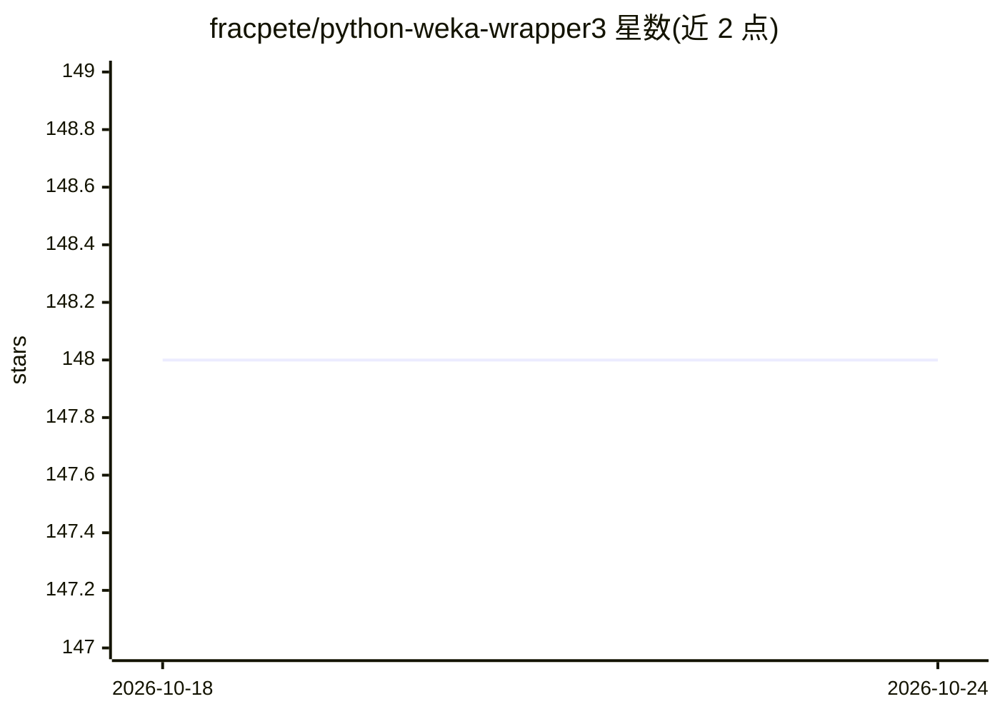

# fracpete/python-weka-wrapper3

⭐ 148 · Python · GPL-3.0 · 推送 2026-04-12 · [GitHub](https://github.com/fracpete/python-weka-wrapper3) · [官网](https://fracpete.github.io/python-weka-wrapper3/) · 个人维护

**通过 JPype 在 Python 3 中调用 Java 机器学习工具箱 Weka 的封装库**

Python 3 封装库，经由 jpype 桥接在 Python 中调用 Java 机器学习工作台 Weka 3.9.7 的功能。运行要求 Python 3、jpype1 与 OpenJDK 11（或更新版本），matplotlib、pygraphviz、PIL、lxml 为可选依赖。安装文档位于独立站点，部分库需从源码编译，需自备构建环境；另提供预构建 Docker 镜像供免安装运行。文档包含示例 API 说明，另有独立的示例代码仓库，问题讨论通过 Google Group 进行。

## 筛选速览

| 维度 | 判定 | 备注 |
|---|---|---|
| AI 角色 | `ai-native` | 本体是模型或模型工具 |
| 许可风险 | `viral` | GPL-3.0 |
| 部署形态 | `library` | 以包/库形式分发 |
| 模型依赖 | — | README 未给出锁定关系 |
| 硬件要求 | — | 无带数字的原话,不猜 |
| 安装摩擦 | `medium` | 含编译或系统依赖之一 |
| 成熟度 | — | 结构信号不足 |

## 能力要点

- 通过 JPype 在 Python 3 中调用 Weka 3.9.7
- 提供预构建 Docker 镜像，可免本地安装运行
- 独立示例代码仓库覆盖各 API

## 适用场景

- 在 Python 工作流中使用 Weka 的机器学习算法
- 复用既有 Weka 代码或流程并接入 Python 生态
- 通过 Docker 镜像避免本地编译安装

## 场景标签

 · 领域:机器学习工具库

## 证据(README 行号)

> L3: Python wrapper for the Java machine learning workbench Weka
> L17: * Weka (3.9.7)

## 星数曲线

2026-10-18 148 → 2026-10-24 148（+0）

---
*卡片 v1 · prompt 1.4 · 生成 2026-10-22 · 置信度 low · 依据 README sha `5bc91feb2163` · [字段定义](../../DATASET.md)*
