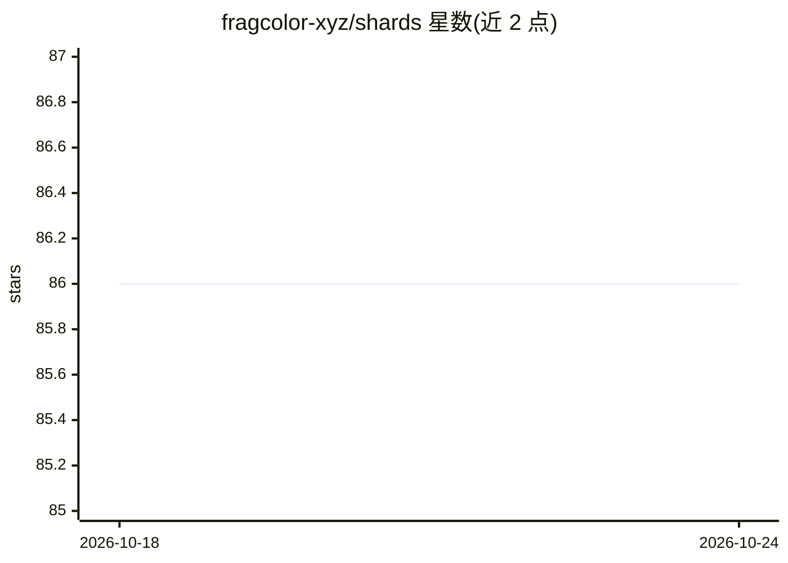

# fragcolor-xyz/shards

⭐ 86 · C++ · BSD-3-Clause · 推送 2026-10-04 · [GitHub](https://github.com/fragcolor-xyz/shards) · 组织维护

**面向视觉与 AI 辅助开发的数据流编程语言**

Shards 是一门多平台、类型安全的编程语言，以数据流为核心范式：用管道操作符（|）连接变换，无传统变量赋值，可视化编程块与代码 1:1 映射。技术上采用 C++/Rust 内核，内建 wire 并发系统与协作式调度，支持编译期类型检查、类型推断与零开销抽象，可与 C++/Rust 互操作，标准库含 828+ 个内置 shard。面向游戏开发、交互应用、数据处理与实时系统的开发者；README 提及其支撑下一代 AI 辅助开发工具，但未给出具体安装命令。

## 筛选速览

| 维度 | 判定 | 备注 |
|---|---|---|
| AI 角色 | `ai-enhanced` | 去掉 AI 部分产品仍成立 |
| 许可风险 | `permissive` | BSD-3-Clause |
| 部署形态 | `None` |  |
| 模型依赖 | — | README 未给出锁定关系 |
| 硬件要求 | — | 无带数字的原话,不猜 |
| 安装摩擦 | `low` | 无编译、无系统依赖或容器化 |
| 成熟度 | — | 结构信号不足 |

## 能力要点

- 管道操作符的数据流编程范式，可视化块与代码 1:1 映射
- C++/Rust 内核，wire 系统内建并发与协作调度
- 828+ 内置 shard 的标准库
- 与 C++/Rust 等语言的互操作

## 适用场景

- 用数据流范式编写游戏或实时交互应用
- 以可视化块方式进行编程
- 做数据处理与系统集成

## 场景标签

 · 领域:编程语言/开发工具

## 证据(README 行号)

> L70: - **AI-Ready**: Powers next-gen AI-assisted development tools
> L8: Shards is a revolutionary programming language that mirrors how data naturally moves in real systems. Unlike traditi

## 星数曲线

2026-10-18 86 → 2026-10-24 86（+0）

---
*卡片 v1 · prompt 1.4 · 生成 2026-10-24 · 置信度 mid · 依据 README sha `1f7ad5d920c1` · [字段定义](../../DATASET.md)*
