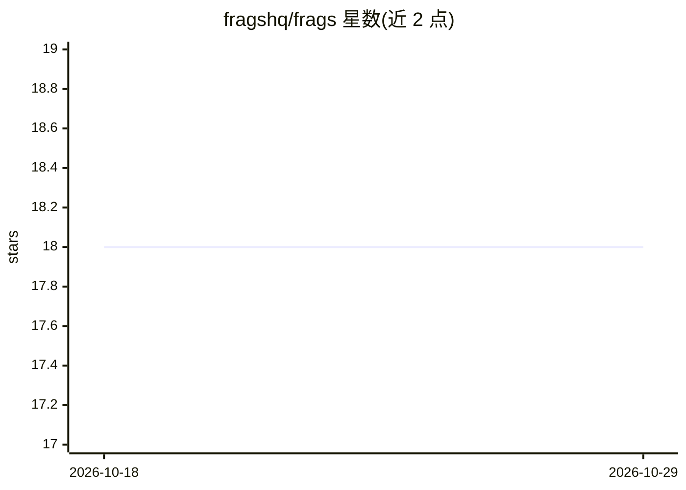

# fragshq/frags

⭐ 18 · Go · AGPL-3.0 · 推送 2026-10-27 · [GitHub](https://github.com/fragshq/frags) · 组织维护

**面向工程师的 Go AI Agent：执行复杂数据检索/转换/提取/聚合工作流**

以 CLI 工具和 Go 库形式提供的 LLM Agent 系统，面向工程师与专业人员构建复杂数据工作流：检索、转换、提取与聚合，产出结构化、机器可消费的输出。关键机制包括多 LLM 支持、集成内部工具与外部 MCP 服务器的标准化工具系统、多会话的上下文组织、输出分段、自定义前后处理步骤。README 声明项目仍在开发中，完整文档在 Wiki。未给出安装命令。

## 筛选速览

| 维度 | 判定 | 备注 |
|---|---|---|
| AI 角色 | `ai-ecosystem` | LLM/agent 周边工具 |
| 许可风险 | `viral` | AGPL-3.0 |
| 部署形态 | `None` |  |
| 模型依赖 | — | README 未给出锁定关系 |
| 硬件要求 | — | 无带数字的原话,不猜 |
| 安装摩擦 | `low` | 无编译、无系统依赖或容器化 |
| 成熟度 | `idea` | |

## 能力要点

- CLI 工具与 Go 库两种交付形式
- 多 LLM 支持与标准化工具集成（含 MCP 服务器）
- 多会话系统组织 LLM 上下文
- 输出分段与自定义前后处理步骤

## 适用场景

- 从文档定义复杂提取管道，输出预定义字段结构
- 设计结构化研究/报告模板并接入数据源生成报告
- 把笔记按设计好的结构扩展为完整文档

## 场景标签

`Agent 框架` · 领域:Agent 开发

## 证据(README 行号)

> L10: Frags comes as a **CLI tool** and as a **library to be integrated into Golang projects**.
> L16: * **Orchestration system:** Frags **is not** an agent to which you ask a question a simple answer back. The whole

## 星数曲线

2026-10-18 18 → 2026-10-29 18（+0）

---
*卡片 v1 · prompt 1.4 · 生成 2026-10-29 · 置信度 mid · 依据 README sha `2f6a2820880e` · [字段定义](../../DATASET.md)*
