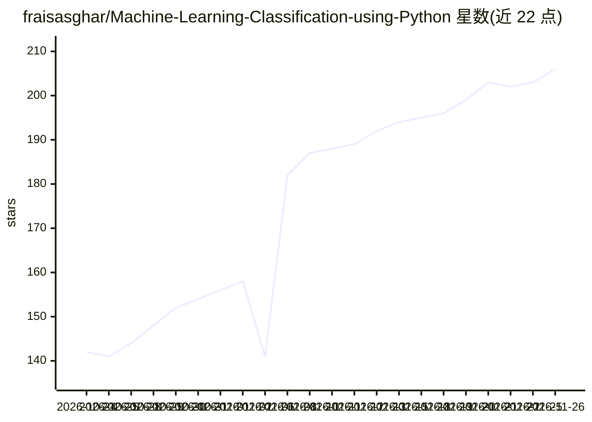

# fraisasghar/Machine-Learning-Classification-using-Python

⭐ 206 · Python · MIT · 推送 2026-11-19 · [GitHub](https://github.com/fraisasghar/Machine-Learning-Classification-using-Python) · 个人维护

**用 Python 与决策树对股票数据做分类的示例项目**

面向学习者的 Python 机器学习分类演示项目：对包含 1,833 条股票价格与交易量的数据集做预处理、探索性可视化（matplotlib/seaborn），训练 Decision Tree 分类器并用 GridSearchCV 调参，通过混淆矩阵、分类报告与决策边界图评估结果，README 记录调参前后准确率从 90% 到 91%。通过 git clone 获取仓库，pip 安装依赖库后在 Jupyter Notebook 或脚本中按顺序运行。

## 筛选速览

| 维度 | 判定 | 备注 |
|---|---|---|
| AI 角色 | `ai-knowledge` | 知识聚合/清单类 |
| 许可风险 | `permissive` | MIT |
| 部署形态 | `library` | 以包/库形式分发 |
| 模型依赖 | — | README 未给出锁定关系 |
| 硬件要求 | — | 无带数字的原话,不猜 |
| 安装摩擦 | `low` | 无编译、无系统依赖或容器化 |
| 成熟度 | — | 结构信号不足 |

## 能力要点

- 端到端流程：数据预处理、EDA、训练、GridSearchCV 调参、评估
- Decision Tree 树结构与决策边界可视化
- 混淆矩阵与 precision/recall/F1 分类报告
- README 附调参前后的分类结果对比

## 适用场景

- 学习决策树分类的完整流程示例
- 参考混淆矩阵与决策边界的可视化做法
- 股票价格与交易量数据的分类实验复现

## 场景标签

`教程课程` · 领域:学习与行业

## 证据(README 行号)

> L15: This project implements machine learning classification techniques using Python to analyze and interpret data patte
> L17: The project demonstrates end-to-end machine learning workflow including data preprocessing, exploratory data analys

## 星数曲线

2026-10-24 142 → 2026-11-26 206（+64）

---
*卡片 v1 · prompt 1.4 · 生成 2026-11-25 · 置信度 high · 依据 README sha `24c9255ad47f` · [字段定义](../../DATASET.md)*
