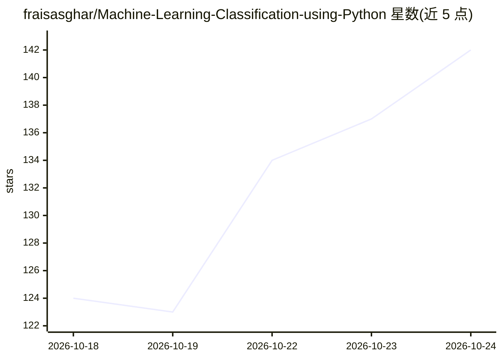

# fraisasghar/Machine-Learning-Classification-using-Python

⭐ 141 · Python · MIT · 推送 2026-10-24 · [GitHub](https://github.com/fraisasghar/Machine-Learning-Classification-using-Python) · 个人维护

**用 Python 决策树对 7 只股票做分类的机器学习教学项目**

基于 Python 的端到端机器学习分类项目：使用包含 1,833 条样本、2 个数值特征（股价、交易量）的数据集，以 7 只股票名称为分类目标，完成数据预处理、探索性数据分析、决策树模型训练、GridSearchCV 超参数调优与评估，调优后准确率 91%。评估手段包括分类报告、混淆矩阵、决策边界可视化与决策树结构图。README 未给出安装或运行命令，项目定位为机器学习工作流演示。

## 筛选速览

| 维度 | 判定 | 备注 |
|---|---|---|
| AI 角色 | `ai-native` | 本体是模型或模型工具 |
| 许可风险 | `permissive` | MIT |
| 部署形态 | `None` |  |
| 模型依赖 | — | README 未给出锁定关系 |
| 硬件要求 | — | 无带数字的原话,不猜 |
| 安装摩擦 | `low` | 无编译、无系统依赖或容器化 |
| 成熟度 | — | 结构信号不足 |

## 能力要点

- 决策树分类 7 只股票（1,833 样本，股价与交易量两特征）
- GridSearchCV 超参数调优，调优后准确率 91%
- 分类报告、混淆矩阵与决策边界可视化分析
- 决策树结构与分裂阈值（Gini 指数）展示

## 适用场景

- 学习决策树分类的完整流程（预处理到评估）
- 参考混淆矩阵与决策边界可视化的分析写法
- 了解 GridSearchCV 超参数调优对类别指标的影响

## 场景标签

`教程课程` · 领域:学习与行业

## 证据(README 行号)

> L15: This project implements machine learning classification techniques using Python to analyze and interpret data patte
> L17: The project demonstrates end-to-end machine learning workflow including data preprocessing, exploratory data analys

## 星数曲线

2026-10-18 124 → 2026-10-24 142（+18）

---
*卡片 v1 · prompt 1.4 · 生成 2026-10-22 · 置信度 high · 依据 README sha `622f0e4ee4ed` · [字段定义](../../DATASET.md)*
