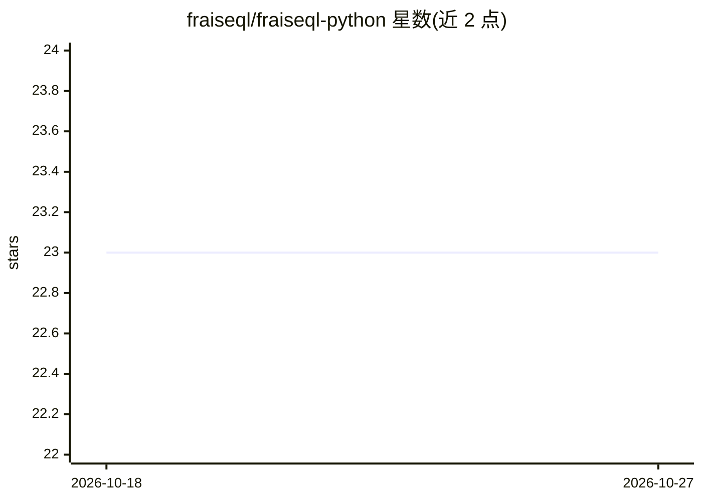

# fraiseql/fraiseql-python

⭐ 23 · Python · MIT · 推送 2026-10-26 · [GitHub](https://github.com/fraiseql/fraiseql-python) · [官网](https://fraiseql.dev) · 个人维护

**基于 FastAPI 的 Python GraphQL 框架，以 PostgreSQL 为中心**

面向已使用 PostgreSQL 的 Python 开发者的 GraphQL 框架：用装饰器声明类型与操作，指向 PostgreSQL 视图（读）与函数（写，CQRS），在 FastAPI 上提供类型化 GraphQL API，无构建步骤与代码生成。热路径由集成 Rust 管线处理 JSONB 转换。限制：仅支持 PostgreSQL；需 Python 3.13/3.14 与 PostgreSQL 13+。另存在架构不同的 v2 项目，两者共用 PyPI 名称，安装需固定 <2。含 pgvector 向量搜索支持用于语义检索与 RAG。

## 筛选速览

| 维度 | 判定 | 备注 |
|---|---|---|
| AI 角色 | `ai-enhanced` | 去掉 AI 部分产品仍成立 |
| 许可风险 | `permissive` | MIT |
| 部署形态 | `library` | 以包/库形式分发 |
| 模型依赖 | — | README 未给出锁定关系 |
| 硬件要求 | — | 无带数字的原话,不猜 |
| 安装摩擦 | `low` | 无编译、无系统依赖或容器化 |
| 成熟度 | — | 结构信号不足 |

## 能力要点

- 装饰器声明 + PostgreSQL 视图/函数，无构建步骤与代码生成
- Rust 管线处理 JSONB 到 HTTP 响应的热路径转换
- pgvector 集成提供 6 种距离运算符的语义搜索
- 50+ 专用标量类型与 AND/OR/NOT 嵌套过滤

## 适用场景

- 为已有 PostgreSQL 库快速搭建数据库优先的 GraphQL API
- 多租户 SaaS 场景下用视图作为结构化安全契约
- 在同一个框架内做 RAG/语义检索的向量查询 API

## 场景标签

`语义搜索` · 领域:知识与检索

## 证据(README 行号)

> L9: **A Python GraphQL framework for PostgreSQL.** Declare types and operations with
> L115: - **Vector search** — pgvector integration for semantic

## 星数曲线

2026-10-18 23 → 2026-10-27 23（+0）

---
*卡片 v1 · prompt 1.4 · 生成 2026-10-27 · 置信度 mid · 依据 README sha `bde1e4ca9a2e` · [字段定义](../../DATASET.md)*
