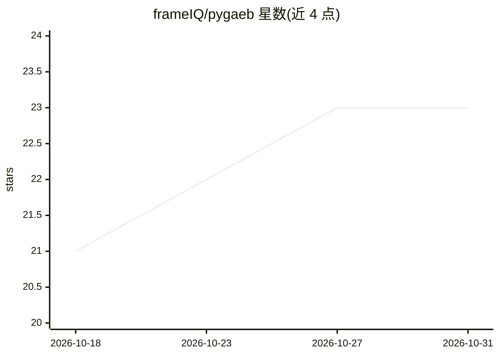

# frameIQ/pygaeb

⭐ 23 · Python · MIT · 推送 2026-10-30 · [GitHub](https://github.com/frameIQ/pygaeb) · [官网](https://pygaeb.readthedocs.io/) · 个人维护

**德国建筑招标 GAEB DA XML 文件的解析/校验/转换 Python 库**

面向建筑工程造价与招投标领域的 Python 库：解析、校验、写入并转换 GAEB DA XML 2.0–3.3 文件，统一为 Pydantic v2 域模型，覆盖招标、投标、贸易、成本计算与工程量确定等全部交换阶段（X31–X97）。可导出 PDF、Excel、Word、HTML、Markdown、CSV 与 pandas DataFrame，支持跨阶段校验、文档 diff、程序化构建 BoQ 与版本升降级。核心功能零 LLM 依赖；可选 LLM 分类层经 LiteLLM 为条目附加语义构件类型并抽取结构化属性（100+ 供应商，可插拔缓存），另提供 MCP server 将 GAEB 文档暴露给 LLM agent。要求 Python 3.10+。

## 筛选速览

| 维度 | 判定 | 备注 |
|---|---|---|
| AI 角色 | `ai-enhanced` | 去掉 AI 部分产品仍成立 |
| 许可风险 | `permissive` | MIT |
| 部署形态 | `library` | 以包/库形式分发 |
| 模型依赖 | — | README 未给出锁定关系 |
| 硬件要求 | — | 无带数字的原话,不猜 |
| 安装摩擦 | `low` | 无编译、无系统依赖或容器化 |
| 成熟度 | — | 结构信号不足 |

## 能力要点

- DA XML 2.0–3.3 全版本自动检测解析与往返写回
- 多格式导出：PDF/Excel/Word/HTML/Markdown/CSV/pandas
- 跨阶段校验（X83→X84、X86→X89 单价匹配）与带重要性分类的文档 diff
- 可选 LLM 分类与结构化抽取（LiteLLM，100+ 供应商）及 MCP server
- XML 安全加固：XXE 防护、实体膨胀防护、文件大小与递归限制

## 适用场景

- 解析并校验德国 GAEB 格式的招标书、投标书与工程量清单
- 将工程量清单导出为 Excel/PDF/Markdown 供审阅或接入 LLM 流程
- 比对两版 BoQ 的结构差异与财务影响
- 用 LLM 为清单条目自动分类并抽取门窗墙管等规格属性

## 场景标签

`文档解析` · 领域:知识与检索

## 证据(README 行号)

> L39: # Core parser + writer + export (zero LLM dependencies)
> L16: An optional LLM classification layer enriches each item with a semantic construction element type via LiteLLM (100+

## 星数曲线

2026-10-18 21 → 2026-10-31 23（+2）

---
*卡片 v1 · prompt 1.4 · 生成 2026-10-27 · 置信度 high · 依据 README sha `055cc2196c95` · [字段定义](../../DATASET.md)*
