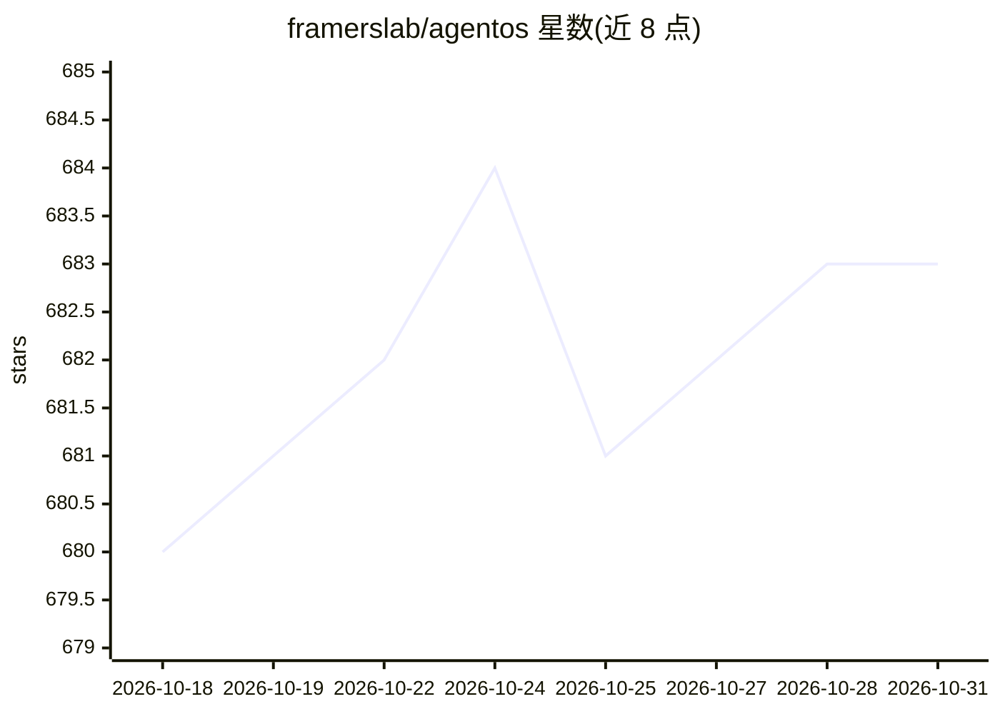

# framerslab/agentos

⭐ 683 · TypeScript · Apache-2.0 · 推送 2026-10-30 · [GitHub](https://github.com/framerslab/agentos) · [官网](https://docs.agentos.sh) · 组织维护

**TypeScript AI agent 框架：持久认知记忆与运行时工具锻造**

面向 TypeScript 开发者的开源 AI agent 框架（Apache-2.0，npm 包 @framers/agentos）：提供持久认知记忆（8 种神经科学机制、Ebbinghaus 衰减）、可选 HEXACO 人格向量、运行时工具锻造（agent 编写 JS 函数经 LLM judge 审批后加入工具列表）、多 agent 编排（多种策略）、guardrails、RAG 管线与语音通道，统一接口接入 13 个 LLM 提供商（含 2 个本地 CLI）。另带 100+ 扩展与 88 个技能的独立包及注册表。限制：node:vm 非安全边界，锻造代码默认关闭需显式开启。

## 筛选速览

| 维度 | 判定 | 备注 |
|---|---|---|
| AI 角色 | `ai-ecosystem` | LLM/agent 周边工具 |
| 许可风险 | `permissive` | Apache-2.0 |
| 部署形态 | `library` | 以包/库形式分发 |
| 模型依赖 | local-ok | 支持本地模型 |
| 硬件要求 | — | 无带数字的原话,不猜 |
| 安装摩擦 | `low` | 无编译、无系统依赖或容器化 |
| 成熟度 | — | 结构信号不足 |

## 能力要点

- 持久认知记忆含 8 种机制（再巩固、检索诱导遗忘等）与 Ebbinghaus 衰减
- 运行时工具锻造：测试用例 + LLM judge 审批，可在 QuickJS WASM 沙箱执行
- 统一接口接入 13 个 LLM 提供商（含 Ollama 本地 CLI）
- 100+ 扩展与 88 个 SKILL.md 技能以独立包提供

## 适用场景

- 构建带长期记忆的多轮对话 agent
- 多 agent 团队编排与工作流 DAG
- 让 agent 在运行中自建并通过审批新增工具

## 场景标签

`Agent 框架` `Agent 记忆` `多智能体` · 领域:Agent 开发

## 证据(README 行号)

> L7: **Agents that remember, forge their own tools, and survive long-running sessions.** Persistent cognitive memory, opt
> L23: AgentOS is an open-source TypeScript framework for AI agents that **remember, adapt, and write their own tools**.

## 星数曲线

2026-10-18 680 → 2026-10-31 683（+3）

---
*卡片 v1 · prompt 1.4 · 生成 2026-10-21 · 置信度 high · 依据 README sha `0f3deaa7a19d` · [字段定义](../../DATASET.md)*
