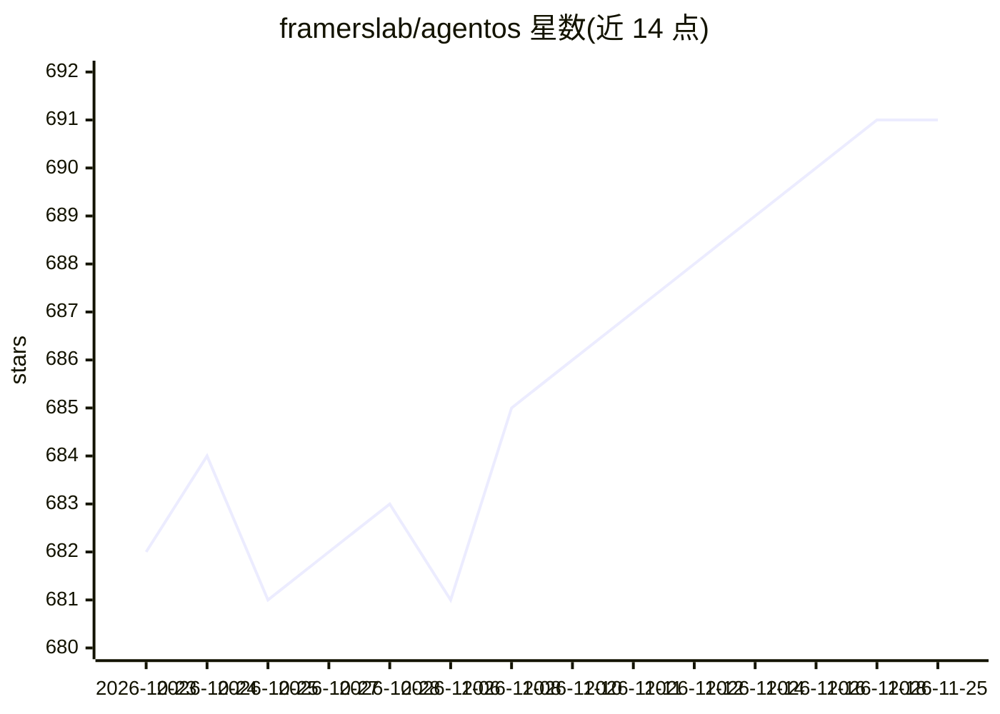

# framerslab/agentos

⭐ 691 · TypeScript · Apache-2.0 · 推送 2026-11-24 · [GitHub](https://github.com/framerslab/agentos) · [官网](https://docs.agentos.sh) · 组织维护

**TypeScript AI agent 框架：认知记忆、人格与运行时工具锻造**

面向 TypeScript 开发者的开源 AI agent 框架（Apache-2.0），核心机制包括带遗忘曲线与 8 种神经科学机制的认知记忆、可选 HEXACO 人格向量、运行时工具锻造（agent 编写 JS 函数并经测试用例与 LLM judge 审批后加入工具列表，在 node:vm 或 QuickJS WASM 沙箱运行）、GMI 会话运行时与 7 种多智能体编排策略。提供统一分发接口接入 13 个 LLM 提供商、RAG 管线、guardrails、语音/电话与 37 个渠道适配器。通过 npm 安装。

## 筛选速览

| 维度 | 判定 | 备注 |
|---|---|---|
| AI 角色 | `ai-ecosystem` | LLM/agent 周边工具 |
| 许可风险 | `permissive` | Apache-2.0 |
| 部署形态 | `library` | 以包/库形式分发 |
| 模型依赖 | local-ok | 支持本地模型 |
| 硬件要求 | — | 无带数字的原话,不猜 |
| 安装摩擦 | `low` | 无编译、无系统依赖或容器化 |
| 成熟度 | — | 结构信号不足 |

## 能力要点

- 持久认知记忆：Ebbinghaus 遗忘衰减等 8 种机制
- 运行时工具锻造：LLM judge 审批后在 node:vm/QuickJS WASM 沙箱执行
- 13 个 LLM 提供商统一接口（含 Ollama 及 2 个本地 CLI）
- 7 种多智能体编排策略与 guardrails、语音/37 渠道适配器

## 适用场景

- 构建具备长期记忆与工具自我扩展的 agent 应用
- 多智能体协作与工作流 DAG 编排
- 需要人格化、情绪追踪的对话 agent（SOUL.md 身份文件）
- 接入多个 LLM 提供商并统一管理 prompt 缓存与成本

## 场景标签

`Agent 框架` `Agent 记忆` `多智能体` `RAG` · 领域:Agent 开发

## 证据(README 行号)

> L5: # **AgentOS** · TypeScript AI Agent Framework
> L23: AgentOS is an open-source TypeScript framework for AI agents that **remember, adapt, and write their own tools**.
> L119: |**LLM Providers**|13 (11 by API key or base URL + 2 local CLI): OpenAI, Anthropic, Gemini, Groq, Ollama, OpenRout

## 星数曲线

2026-10-23 682 → 2026-11-25 691（+9）

---
*卡片 v1 · prompt 1.4 · 生成 2026-11-25 · 置信度 high · 依据 README sha `1a26088967a2` · [字段定义](../../DATASET.md)*
