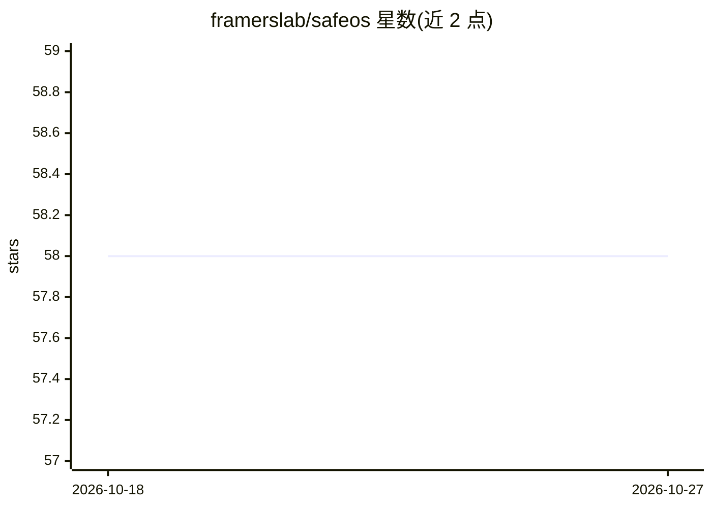

# framerslab/safeos

⭐ 58 · TypeScript · MIT · 推送 2026-05-30 · [GitHub](https://github.com/framerslab/safeos) · [官网](https://safeos.sh/) · 组织维护

**浏览器端本地运行的宠物/婴儿/老人 AI 监控 PWA**

Progressive Web App，将带摄像头和麦克风的设备变为深度学习监控站：TensorFlow.js COCO-SSD 做运动门控的目标检测，Transformers.js ViT 做次级场景分类，Web Audio FFT 检测哭声/异响，视觉指纹匹配走失宠物或人员；全部模型在设备端运行，首次加载缓存后可完全离线。面向家庭照护与小型安防场景，提供五级严重度告警分级，可选 API 服务器负责邮件（Resend）/短信（Twilio）/Telegram 分发及本地 Ollama 场景推理桥接。本地模式无遥测、无云端上传，数据存 IndexedDB。README 自称实验性补充工具，不能替代人工看护。

## 筛选速览

| 维度 | 判定 | 备注 |
|---|---|---|
| AI 角色 | `ai-native` | 本体是模型或模型工具 |
| 许可风险 | `permissive` | MIT |
| 部署形态 | `self-host` | docker 或自建部署 |
| 模型依赖 | local-ok | 支持本地模型 |
| 硬件要求 | — | 无带数字的原话,不猜 |
| 安装摩擦 | `low` | 无编译、无系统依赖或容器化 |
| 成熟度 | `idea` | |

## 能力要点

- COCO-SSD + ViT 双级检测管线，全部在浏览器本地运行
- 首次缓存后完全离线，无遥测、无云端上传
- 严重度分级告警，可经可选 API 服务器分发邮件/SMS/Telegram
- 32-bin 颜色直方图 + Sobel 边缘的视觉指纹匹配（<1KB/照片）

## 适用场景

- 用旧手机或带摄像头的设备做婴儿哭声与动作监测
- 独居老人跌倒与长时间不活动告警
- 走失宠物/人员用 1-5 张参考照比对
- 离网或低配硬件上的后院/农场摄像头监控

## 场景标签

`目标检测` · 领域:感知与多模态

## 证据(README 行号)

> L23: SafeOS Guardian is a Progressive Web App that turns any device with a camera and microphone into a deep-learning mo
> L105: 1. **First load.** The Next.js app shell loads from any static host (GitHub Pages, Vercel, Netlify, Cloudflare Pag

## 星数曲线

2026-10-18 58 → 2026-10-27 58（+0）

---
*卡片 v1 · prompt 1.4 · 生成 2026-10-24 · 置信度 high · 依据 README sha `7573525d35be` · [字段定义](../../DATASET.md)*
