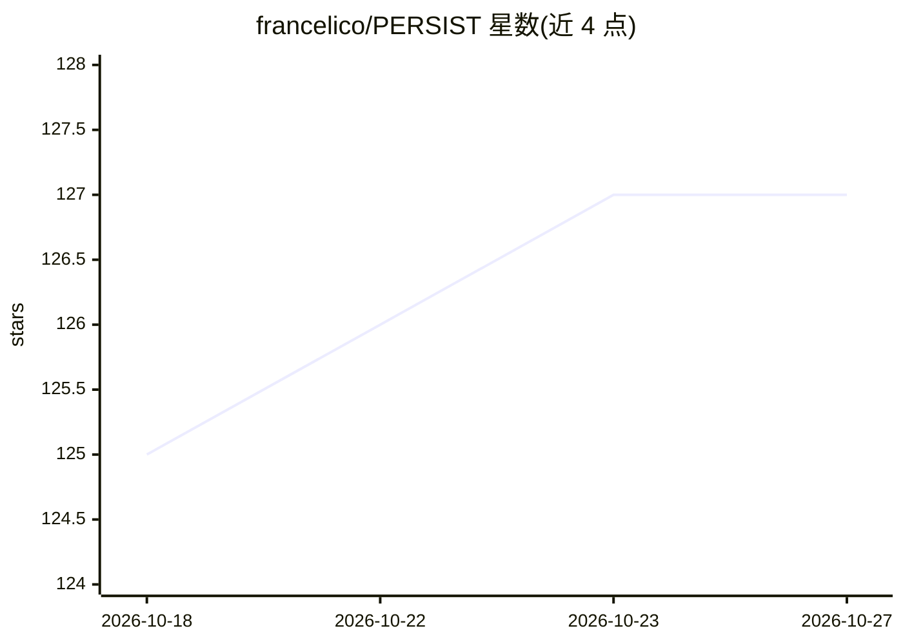

# francelico/PERSIST

⭐ 127 · Python · MIT · 推送 2026-08-12 · [GitHub](https://github.com/francelico/PERSIST) · [官网](https://francelico.github.io/persist.github.io/) · 组织维护

**科研代码：生成可探索体素世界的持久 3D 状态世界模型**

ICML 2026 论文 Beyond Pixel Histories 的官方代码库。PERSIST 是基于体素的潜在扩散世界模型：给定初始图像与相机位姿，依据玩家动作自回归地预测未来体素世界状态、像素观测与相机状态。生成走多阶段管线：体素去噪器预测下一体素潜在、相机模型预测下一姿态、像素去噪器预测下一观测，两个 VAE 负责体素/像素与潜在空间的映射。提供预训练权重推理（S/XL 变体）、各组件训练脚本、基于 Craftium 的数据集生成流程。安装要求 Ubuntu 22.04 与 CUDA 12.6，版本不匹配会产生生成伪影。

## 筛选速览

| 维度 | 判定 | 备注 |
|---|---|---|
| AI 角色 | `ai-native` | 本体是模型或模型工具 |
| 许可风险 | `permissive` | MIT |
| 部署形态 | `None` |  |
| 模型依赖 | — | README 未给出锁定关系 |
| 硬件要求 | — | 无带数字的原话,不猜 |
| 安装摩擦 | `high` | 编译与系统依赖俱全 |
| 成熟度 | — | 结构信号不足 |

## 能力要点

- 自回归预测体素状态/像素观测/相机状态的多阶段扩散管线
- 生成可持续数千步的交互式可探索体素世界
- 提供 PERSIST-S/XL 预训练权重推理与多 GPU 支持
- 包含 VAE/去噪器/相机模型训练脚本与 Craftium 数据集生成工具

## 适用场景

- 运行预训练模型生成交互式体素世界 rollout
- 复现论文训练流程或训练自己的世界模型
- 用 Craftium 生成新的 Minecraft 环境数据集

## 场景标签

`视频生成` `模型训练` · 领域:内容生成

## 证据(README 行号)

> L8: Official codebase for PERSIST (ICML 2026), a world model that generates coherent rollouts over thousands of steps by
> L13: PERSIST is a voxel-based latent-diffusion **world model**. Given an
> L18: PERSIST autoregressively predicts future

## 星数曲线

2026-10-18 125 → 2026-10-27 127（+2）

---
*卡片 v1 · prompt 1.4 · 生成 2026-10-23 · 置信度 high · 依据 README sha `443e863884b1` · [字段定义](../../DATASET.md)*
