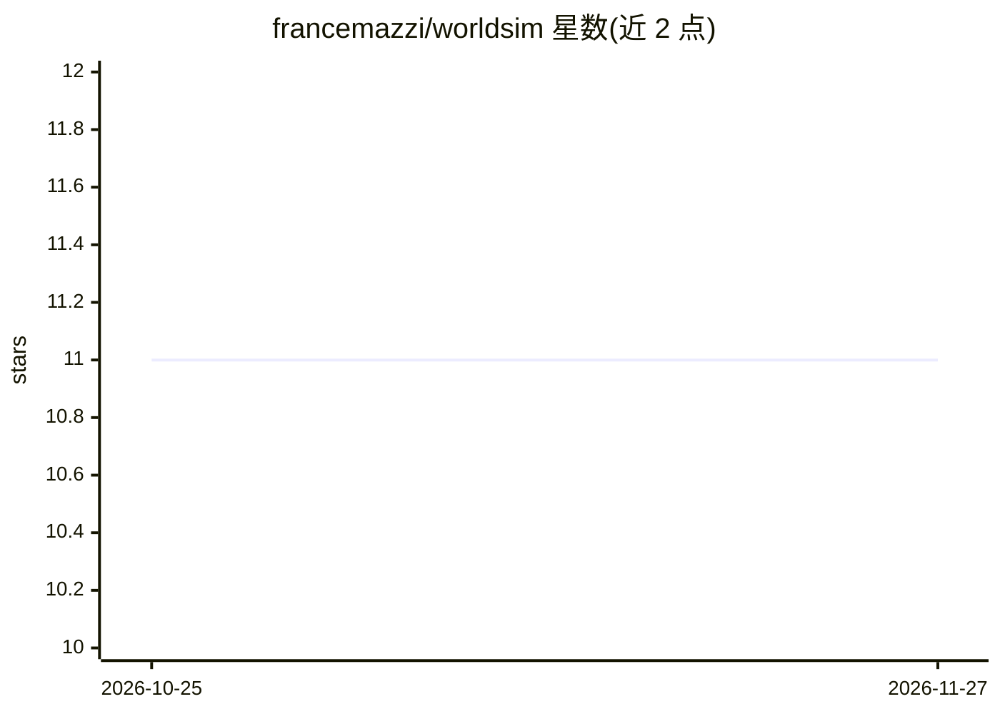

# francemazzi/worldsim

⭐ 11 · TypeScript · MIT · 推送 2026-08-27 · [GitHub](https://github.com/francemazzi/worldsim) · [官网](https://francemazzi.github.io/worldsim/) · 个人维护

**给开发者在 Node.js 中运行多智能体社会模拟的引擎**

WorldSim 是面向 Node.js/TypeScript 的可嵌入多智能体模拟引擎，无状态、插件化。用户定义世界、为 agent 配置人格与目标，可选加载规则或危机触发器，引擎逐 tick 推进，agent 进行推理、对话、使用工具并生成关系与报告。提供人格系统、感知层、关系衰减、规则执行、Redis/Neo4j/PostgreSQL 持久化与 Socket.IO 实时流。附 Studio 仪表盘与跨 LLM 微型对照实验（重现 Emergence World 论文流程），MIT 许可。

## 筛选速览

| 维度 | 判定 | 备注 |
|---|---|---|
| AI 角色 | `ai-ecosystem` | LLM/agent 周边工具 |
| 许可风险 | `permissive` | MIT |
| 部署形态 | `library` | 以包/库形式分发 |
| 模型依赖 | local-ok | 支持本地模型 |
| 硬件要求 | — | 无带数字的原话,不猜 |
| 安装摩擦 | `low` | 无编译、无系统依赖或容器化 |
| 成熟度 | — | 结构信号不足 |

## 能力要点

- LLM-agnostic：支持 OpenAI、Anthropic 代理及 OpenAI 兼容端点
- 通过并发上限与 token 预算支持 1000+ agents
- 规则系统含治理 agent，可自主判定 allowed/warned/blocked
- 内置跨模型对照实验与图表生成脚本

## 适用场景

- 模拟社区对新规则、事件或政策的反应
- 在相同场景下对比不同 LLM 驱动的 agent 群体行为差异
- 搭建需要 agent 关系与社会动态的自定义模拟场景

## 场景标签

`Agent 框架` `多智能体` · 领域:Agent 开发

## 证据(README 行号)

> L10: WorldSim is an embeddable multi-agent simulation engine for Node.js. You define a world, add agents with personalit
> L43: |**LLM-agnostic**|OpenAI, Anthropic proxies, Ollama — anything OpenAI-compatible|

## 星数曲线

2026-10-25 11 → 2026-11-27 11（+0）

---
*卡片 v1 · prompt 1.4 · 生成 2026-11-18 · 置信度 high · 依据 README sha `89d176e30b71` · [字段定义](../../DATASET.md)*
