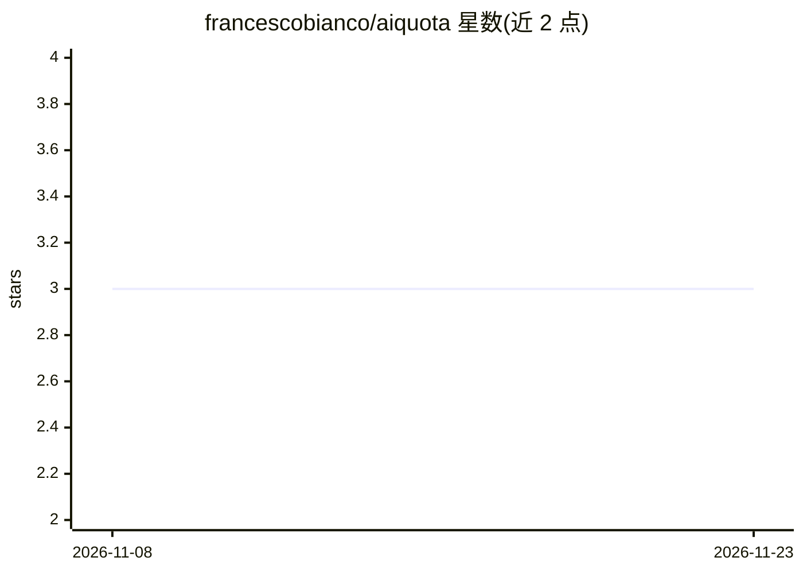

# francescobianco/aiquota

⭐ 3 · Shell · MIT · 推送 2026-11-02 · [GitHub](https://github.com/francescobianco/aiquota) · 个人维护

**终端里显示各 AI 订阅配额余量的 POSIX sh 脚本**

单个 POSIX sh 脚本，安装后在终端打开时显示状态条、在标题栏刷新各 AI 订阅（Claude、ChatGPT/Codex、Copilot、Gemini、OpenCode Go、Freebuff）的剩余配额百分比与重置时间。读取本地各 agent 的凭据，调用与 agent 自身用量页相同的未公开端点，结果缓存于本地以避免打开终端时等待网络。仅支持按时间/资源重置的包月订阅，不查询 API key 与按量计费方案；凭据只读、无服务器、无遥测。依赖 awk 与 curl，支持 bash/zsh/fish/dash 等 shell 与 Linux/macOS。

## 筛选速览

| 维度 | 判定 | 备注 |
|---|---|---|
| AI 角色 | `ai-ecosystem` | LLM/agent 周边工具 |
| 许可风险 | `permissive` | MIT |
| 部署形态 | `None` |  |
| 模型依赖 | — | README 未给出锁定关系 |
| 硬件要求 | — | 无带数字的原话,不猜 |
| 安装摩擦 | `low` | 无编译、无系统依赖或容器化 |
| 成熟度 | — | 结构信号不足 |

## 能力要点

- 单个 POSIX sh 脚本，仅依赖 awk 和 curl
- 终端标题栏与状态条显示各订阅剩余配额与重置时间
- 读取本地缓存，打开终端不等待网络
- 无服务器无遥测，凭据只读且不写入缓存

## 适用场景

- 开终端时先看哪些编码 agent 还有余量再决定用哪个
- 在 tmux 状态栏中常驻显示订阅用量
- 多账号场景自定义显示顺序与名称

## 场景标签

 · 领域:开发者工具/CLI

## 证据(README 行号)

> L10: **See what's left of your AI subscriptions every time you open a terminal.**
> L21: - **Tiny and portable**: one POSIX `sh` script that needs only `awk` and `curl`
> L131: > These are mostly **undocumented endpoints**, the same ones the agents use for their own usage screens.

## 星数曲线

2026-11-08 3 → 2026-11-23 3（+0）

---
*卡片 v1 · prompt 1.4 · 生成 2026-11-22 · 置信度 high · 依据 README sha `4c8f2b4b04b9` · [字段定义](../../DATASET.md)*
