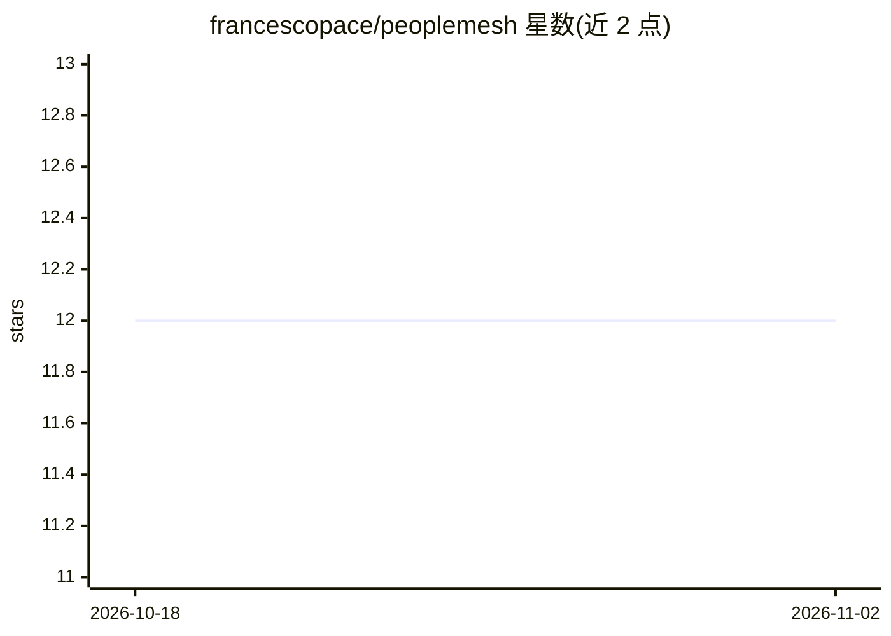

# francescopace/peoplemesh

⭐ 12 · Java · Apache-2.0 · 推送 2026-10-28 · [GitHub](https://github.com/francescopace/peoplemesh) · [官网](https://peoplemesh.org) · 个人维护

**面向企业内部的人员/机会语义匹配与发现平台**

将组织建模为图状 mesh（人员、机会、社区、项目等节点），对节点生成嵌入向量，用户以自然语言查询后经余弦相似度与元数据排序返回匹配结果。提供 Web 应用、API 与 MCP 集成（可接入 ChatGPT/Claude 等 agent），支持简历导入（CV import，Docling/OpenAI）、技能目录与自评。隐私方面含细粒度同意管理、GDPR 数据权利流程与可配置保留策略。技术栈为 Java 25/Quarkus/Maven，本地运行需 Docker（DevServices 自动启动 PostgreSQL pgvector 与 Docling）；核心 Apache-2.0，企业插件（LDAP/Slack 等）另行提供。

## 筛选速览

| 维度 | 判定 | 备注 |
|---|---|---|
| AI 角色 | `ai-native` | 本体是模型或模型工具 |
| 许可风险 | `permissive` | Apache-2.0 |
| 部署形态 | `None` |  |
| 模型依赖 | local-ok | 支持本地模型 |
| 硬件要求 | — | 无带数字的原话,不猜 |
| 安装摩擦 | `medium` | 含编译或系统依赖之一 |
| 成熟度 | — | 结构信号不足 |

## 能力要点

- 图状节点建模 + 嵌入向量 + 余弦相似度与元数据排序的语义搜索
- MCP 集成使 ChatGPT/Claude 等 AI 助手可直接调用搜索
- 细粒度同意管理、GDPR 数据权利流程与假名化审计日志
- DevServices 自动启动 PostgreSQL (pgvector) 与 Docling

## 适用场景

- 在大组织中用一句话找到合适的同事、内部机会或项目
- 通过 ChatGPT/Claude 等 AI 助手以 MCP 方式查询企业人才网络
- 构建符合 GDPR 要求的内部人才发现平台

## 场景标签

`知识图谱` `语义搜索` `文档解析` · 领域:知识与检索

## 证据(README 行号)

> L11: PeopleMesh is the AI-powered matching layer for modern organizations. It helps people discover the right colleagues
> L39: PeopleMesh models the organization as a single graph-like mesh where each entity is a node (people, opportunities, 
> L42: When a user searches, the query is embedded in the same vector space and matched against nodes using vector similar

## 星数曲线

2026-10-18 12 → 2026-11-02 12（+0）

---
*卡片 v1 · prompt 1.4 · 生成 2026-11-01 · 置信度 high · 依据 README sha `25204225fe11` · [字段定义](../../DATASET.md)*
