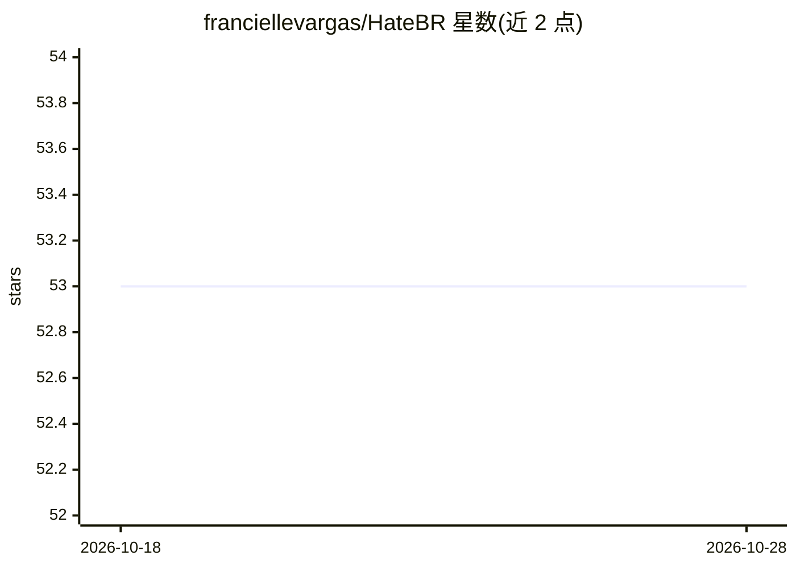

# franciellevargas/HateBR

⭐ 53 · NOASSERTION · 推送 2026-01-05 · [GitHub](https://github.com/franciellevargas/HateBR) · 个人维护

**巴西葡语 Instagram 仇恨言论/冒犯性语言专家标注数据集**

面向自然语言处理研究者的基准数据集：7,000 条巴西 Instagram 针对政客的评论，由三位专家标注，含二元分类（冒犯/非冒犯）、冒犯程度与仇恨对象三层标注（后两者仅 1.0 版）。仓库提供 2.0 版 HateBR 语料及带人工标注依据（rationales）的可解释版 HateBRXplain，并附带 ngram/tfidf 表示与 NB/SVM/MLP/LR 算法的基线模型 .pkl 文件。1.0 版需邮件联系作者获取。许可为 CC BY-NC 4.0，附三篇论文的引用条目。

## 筛选速览

| 维度 | 判定 | 备注 |
|---|---|---|
| AI 角色 | `ai-knowledge` | 知识聚合/清单类 |
| 许可风险 | `none` | NOASSERTION |
| 部署形态 | `None` |  |
| 模型依赖 | — | README 未给出锁定关系 |
| 硬件要求 | — | 无带数字的原话,不猜 |
| 安装摩擦 | `low` | 无编译、无系统依赖或容器化 |
| 成熟度 | — | 结构信号不足 |

## 能力要点

- 7,000 条专家标注的巴西葡语 Instagram 评论，三标注者高一致性
- 三层标注：二元分类/冒犯程度/仇恨言论对象
- HateBRXplain 提供人工标注的可解释性依据
- 附带基线机器学习模型（.pkl，ngram/tfidf × NB/SVM/MLP/LR）

## 适用场景

- 训练和评测巴西葡语冒犯性语言检测模型
- 研究可解释的仇恨言论检测（rationales 基准）
- 复现论文基线结果并开展对比实验

## 场景标签

 · 领域:自然语言处理/内容审核

## 证据(README 行号)

> L5:  HateBR is the first large-scale, expert-annotated dataset of Brazilian Instagram comments for offensive language an
> L29: In addition, we also provide baseline machine learning results for both tasks: offensive language and hate speech d

## 星数曲线

2026-10-18 53 → 2026-10-28 53（+0）

---
*卡片 v1 · prompt 1.4 · 生成 2026-10-24 · 置信度 high · 依据 README sha `fe31775142f4` · [字段定义](../../DATASET.md)*
