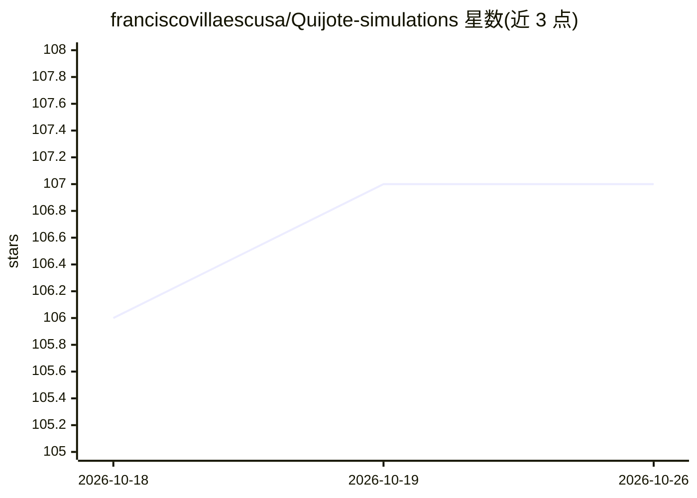

# franciscovillaescusa/Quijote-simulations

⭐ 107 · Python · MIT · 推送 2026-07-14 · [GitHub](https://github.com/franciscovillaescusa/Quijote-simulations) · 个人维护

**宇宙学 N 体模拟大型套件（README 迁移中）**

该项目是一套大规模 N 体宇宙学模拟数据套件，主题标签涉及宇宙学、大尺度结构、数值模拟及机器学习与深度学习、信息抽取。当前 README 仅有一行说明文档正在迁移，未在可见范围内提供功能描述、安装命令或使用方式；描述与标签表明其面向宇宙学数值模拟与相关数据分析的研究人员。具体内容以迁移后的文档为准。

## 筛选速览

| 维度 | 判定 | 备注 |
|---|---|---|
| AI 角色 | `ai-enhanced` | 去掉 AI 部分产品仍成立 |
| 许可风险 | `permissive` | MIT |
| 部署形态 | `None` |  |
| 模型依赖 | — | README 未给出锁定关系 |
| 硬件要求 | — | 无带数字的原话,不猜 |
| 安装摩擦 | `low` | 无编译、无系统依赖或容器化 |
| 成熟度 | — | 结构信号不足 |

## 能力要点

- 大规模 N 体宇宙学模拟套件
- 主题涉及大尺度结构与数值模拟
- 标签含机器学习/深度学习与信息抽取

## 适用场景

- 宇宙学大尺度结构研究使用模拟数据
- 基于模拟数据开展机器学习信息抽取研究

## 场景标签

 · 领域:宇宙学/数值模拟

## 证据(README 行号)

> L1: ## The documentation is being moved to here

## 星数曲线

2026-10-18 106 → 2026-10-26 107（+1）

---
*卡片 v1 · prompt 1.4 · 生成 2026-10-23 · 置信度 low · 依据 README sha `d11f97f6bc9d` · [字段定义](../../DATASET.md)*
