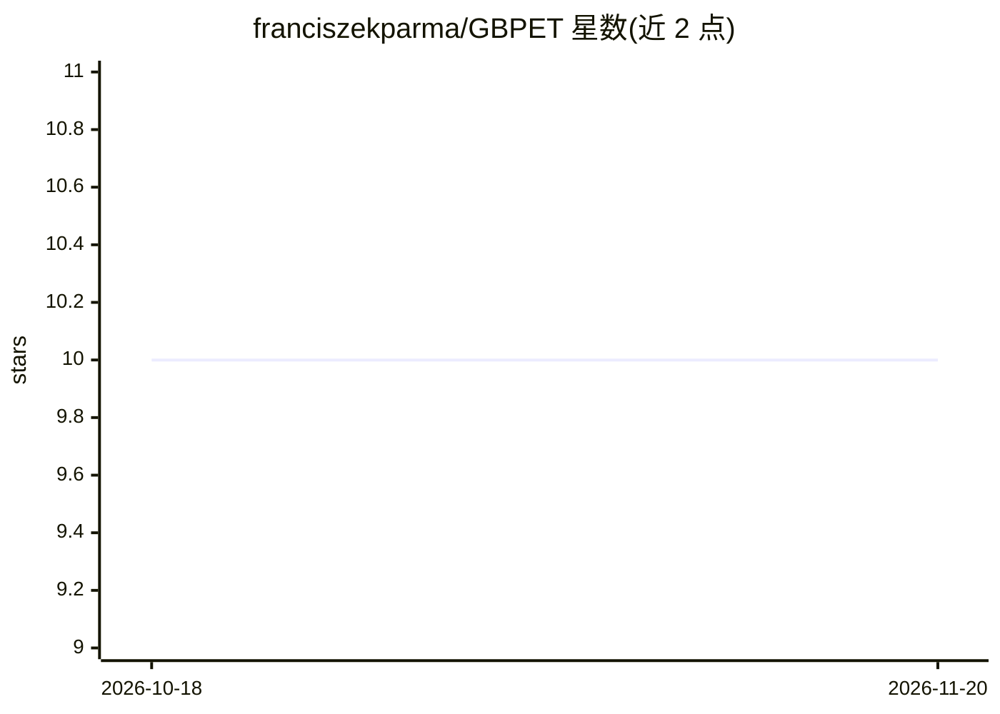

# franciszekparma/GBPET

⭐ 10 · Python · MIT · 推送 2026-05-05 · [GitHub](https://github.com/franciszekparma/GBPET) · 个人维护

**从零实现的 GPT 语言模型与 BPE 分词器教学项目**

用 PyTorch 从零构建的 GPT 风格 decoder-only transformer，约 20M 参数，不依赖 HuggingFace 与预训练权重；附带实现 Sennrich 等人 2016 年原始算法的自研 BPE 分词器，支持 BPE 与字符级双模式切换，并含 bigram 基线模型供对比。训练语料为 1500 万字符的狄更斯小说，提供 checkpoint 保存与恢复、学习率 warmup+余弦退火调度。项目定位为教学目的，README 列出上下文长度固定 256 token、仅单语料训练等限制。

## 筛选速览

| 维度 | 判定 | 备注 |
|---|---|---|
| AI 角色 | `ai-native` | 本体是模型或模型工具 |
| 许可风险 | `permissive` | MIT |
| 部署形态 | `library` | 以包/库形式分发 |
| 模型依赖 | — | README 未给出锁定关系 |
| 硬件要求 | — | 无带数字的原话,不猜 |
| 安装摩擦 | `low` | 无编译、无系统依赖或容器化 |
| 成熟度 | — | 结构信号不足 |

## 能力要点

- 自研 BPE 分词器实现 Sennrich et al. (2016) 原始算法，支持与字符级模式切换
- decoder-only transformer（8 头注意力、8 层 block、256 上下文、~20M 参数）
- checkpoint 完整保存模型、优化器、调度器与分词器状态
- 附带 bigram 基线模型用于性能对比

## 适用场景

- 学习 GPT 架构与 BPE 分词的底层实现原理
- 在自己租用的 GPU 上复现小型语言模型训练流程
- 基于 2048 词表的小模型生成狄更斯风格文本

## 场景标签

`模型训练` `教程课程` · 领域:学习与行业

## 证据(README 行号)

> L3: A **PyTorch** implementation of a **GPT-style decoder-only transformer** with a custom **Byte Pair Encoding tokenize
> L13: GPT (Generative Pre-trained Transformer) is a decoder-only transformer architecture that generates text autoregress
> L17: - **Custom BPE tokenizer** implementing the original algorithm from Sennrich et al. (2016)

## 星数曲线

2026-10-18 10 → 2026-11-20 10（+0）

---
*卡片 v1 · prompt 1.4 · 生成 2026-11-19 · 置信度 high · 依据 README sha `e83affe8614a` · [字段定义](../../DATASET.md)*
