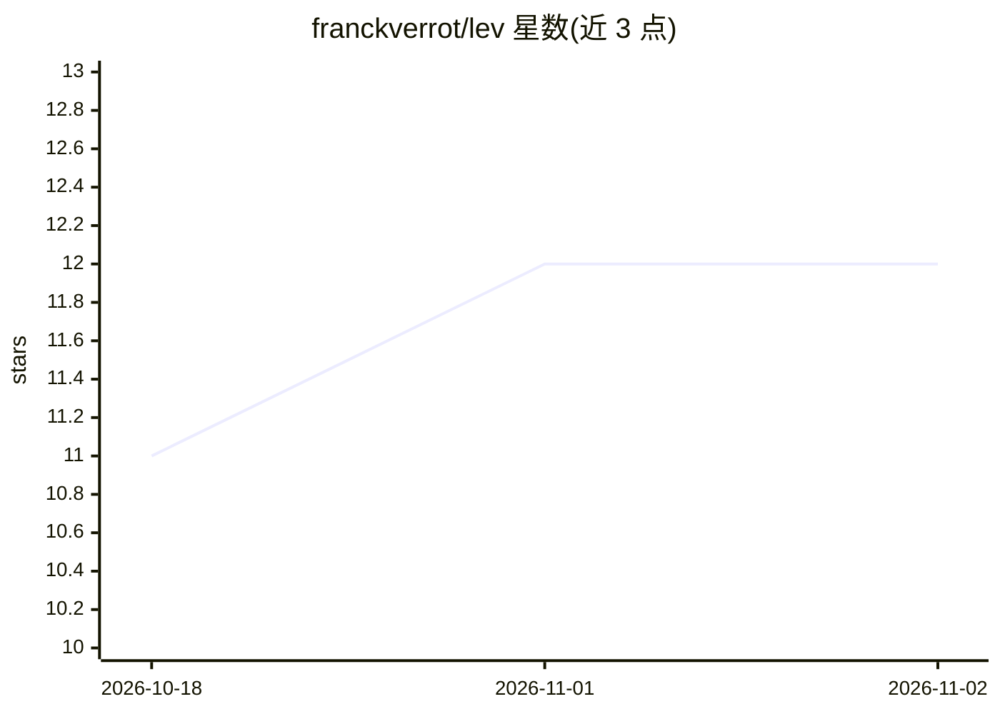

# franckverrot/lev

⭐ 12 · Python · Apache-2.0 · 推送 2026-09-21 · [GitHub](https://github.com/franckverrot/lev) · 个人维护

**Jev 式决策模型原型：基于 LFM2.5-350M 单次前向输出问题概率**

kev 的克隆，将 Qwen 骨干替换为 LiquidAI LFM2.5-350M 的 Jev 风格决策模型：输入一个文档/状态与一组类型化问题，单次前向返回每题每选项的概率，不做文本生成。自述为原型与周末实验。提供兼容 TypeSafe System One 契约的 HTTP API（typesafe-sdk 改 base_url 即可用）、训练脚本与带 x-ray 追踪的 playground；为适配短卷积骨干引入 prev 指针机制。README 附与 kev/Jev 的准确率与延迟对照表。需 Python 3.12+、uv、Node 20+，在 Apple Silicon 上开发。

## 筛选速览

| 维度 | 判定 | 备注 |
|---|---|---|
| AI 角色 | `ai-native` | 本体是模型或模型工具 |
| 许可风险 | `permissive` | Apache-2.0 |
| 部署形态 | `library` | 以包/库形式分发 |
| 模型依赖 | — | README 未给出锁定关系 |
| 硬件要求 | — | 无带数字的原话,不猜 |
| 安装摩擦 | `low` | 无编译、无系统依赖或容器化 |
| 成熟度 | `idea` | |

## 能力要点

- 单次前向对多问题输出选项概率，非文本生成
- 兼容 TypeSafe System One API 契约，typesafe-sdk 可直接对接
- 针对 LFM2.5 短卷积层的 prev 指针序列打包机制
- playground 带 /xray 请求追踪（注意力权重、逐层差异、LoRA 更新等）

## 适用场景

- 给定文档与问题集，本地获取各选项概率的决策判定
- 研究短卷积骨干在 Jev 式决策架构上的适配与表现
- 借助 x-ray 检视模型对状态与问题的内部注意力行为

## 场景标签

`微调` · 领域:训练与推理

## 证据(README 行号)

> L3: lev's a clone of kev, Jared Palmer's Jev-style decision model, with the Qwen backbone replaced by LiquidAI's LFM2.5-
> L5: Just like Jev, you give it one document / the state and a set of typed questions, and it returns a probability for e

## 星数曲线

2026-10-18 11 → 2026-11-02 12（+1）

---
*卡片 v1 · prompt 1.4 · 生成 2026-11-01 · 置信度 mid · 依据 README sha `fa7457594250` · [字段定义](../../DATASET.md)*
